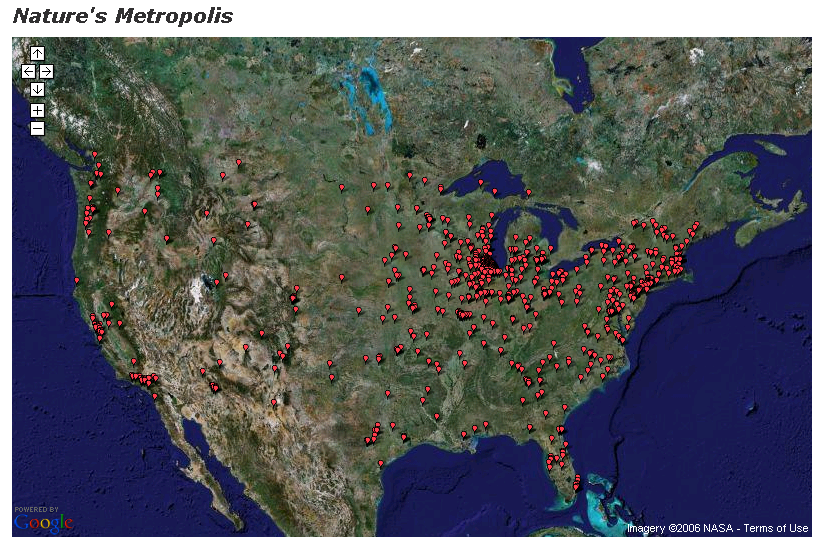
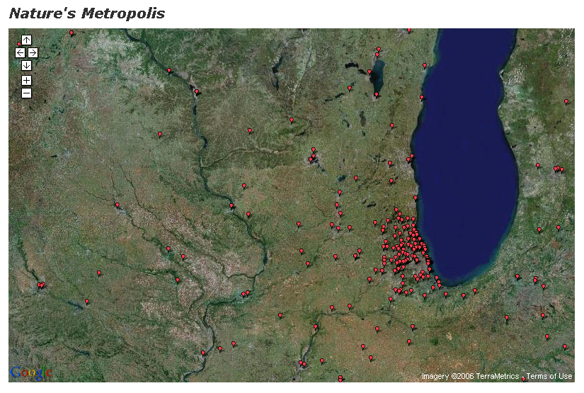

# Nature's Metropolis and Its Hinterland

_September 4, 2006_  
Originally published at `https://digitalhistoryhacks.blogspot.com/2006/09/natures-metropolis-and-its-hinterland.html`

Fifteen years ago William Cronon[^1] published *Nature's Metropolis: Chicago and the Great West[^2]*, a book that has become something of a classic in environmental history and many other fields. In the book, Cronon shows how the history of nineteenth-century Chicago wasn't merely the history of a city, but rather the history of the relations between a city and the hinterland that it dominated. This was a fairly novel perspective since the history of the American West has often been viewed in terms of a frontier[^3]. (*Nature's Metropolis* seems less revolutionary from the perspective of Canadian historiography, which already had a metropolitan-hinterland thesis[^4], but it's a great book nonetheless.)  

Thinking idly about the historiographical significance of Cronon's book, I got to wondering what kind of hinterland it dominates. That is to say, where do we find publically accessible copies of *Nature's Metropolis*? Fortunately, the new Open WorldCat[^5] makes it quite easy for a digital history hacker to answer a question like this. First we search for the locations of libraries where the book is held and scrape the addresses[^6]. Then we use a lookup table[^7] to map the zip codes to latitude/longitude pairs. Finally, we hand the whole thing off to Google Maps[^8] to plot the results, shown below.  

  
  

From the maps, it looks as if the hinterland that *Nature's Metropolis* dominates is the northeastern US.  

Tags: application program interface[^9] \| data mining[^10] \| digital history[^11] \| geocoding[^12] \| Google[^13] \| hacking[^14] \| WorldCat[^15]

---

Previous: [Easy Pieces in Python: Simple Scraping](20060903-easy-pieces-in-python-simple-scraping.md)  
Next: [A First Look at Zotero](20060907-first-look-at-zotero.md)  
[Back to the blog archive](../README.md)

[^1]: `http://www.geography.wisc.edu/faculty/cronon/welcome.html`
[^2]: `http://www.worldcat.org/oclc/21971815`
[^3]: `http://www.worldcat.org/oclc/30155026`
[^4]: `http://www.canadianencyclopedia.ca/index.cfm?PgNm=TCE&Params=A1ARTA0005264`
[^5]: `http://worldcat.org`
[^6]: `http://digitalhistoryhacks.blogspot.com/2006/09/easy-pieces-in-python-simple-scraping.html`
[^7]: `http://digitalhistoryhacks.blogspot.com/2006/08/easy-pieces-in-python-lookup-table.html`
[^8]: `http://www.google.com/apis/maps/`
[^9]: `http://technorati.com/tag/application+program+interface`
[^10]: `http://technorati.com/tag/data+mining`
[^11]: `http://technorati.com/tag/digital+history`
[^12]: `http://technorati.com/tag/geocoding`
[^13]: `http://technorati.com/tag/Google`
[^14]: `http://technorati.com/tag/hacking`
[^15]: `http://technorati.com/tag/worldcat`
