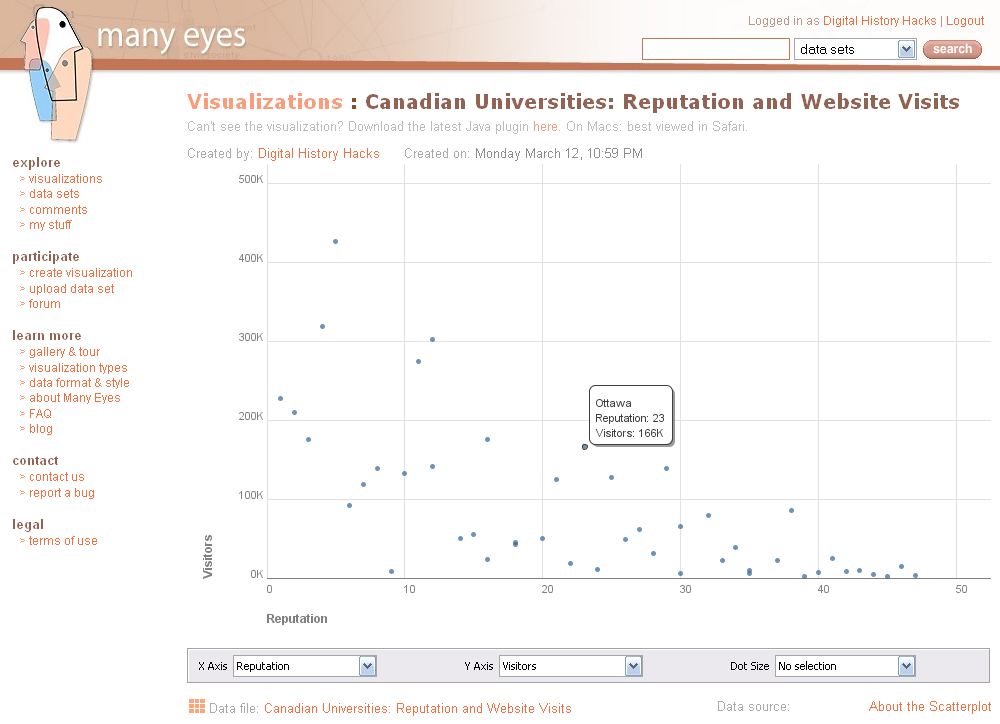
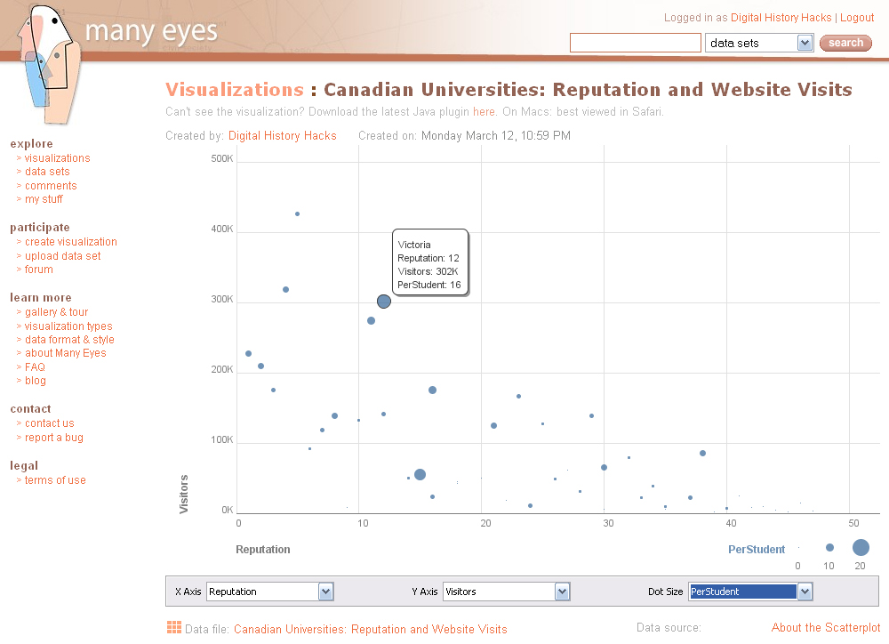

# How To: Do Simple Visualizations

_March 15, 2007_  
Originally published at `https://digitalhistoryhacks.blogspot.com/2007/03/how-to-do-simple-visualizations.html`

One of the hats that I wear requires me to think strategically about the ways that Western's history department[^1] and public history program[^2] are positioned on the web. I spend a certain amount of time studying other departments and programs: who have they hired recently? what grants did they apply for and receive? where and what are they publishing? where do their students end up? what kind of web traffic do they have? which parts of their website are most dynamic? how are they positioned in search engine results?  

On a larger scale, the efforts of any particular department or program are made against the overall output of their university. In *Life Style[^3]*, Bruce Mau writes that "The exercise of producing identity is all about giving environmental noise a defined pattern." So if we think of a departmental identity as a pattern, we can think of the university as providing the environmental noise (or the carrier wave, if you prefer) that is being modulated.  

The point of visualization is to use your eyes to find interesting patterns in data that you might otherwise miss. IBM's Many Eyes[^4] web service makes it easy to do simple visualizations without any programming. For example, in order to assess the relative positioning of Canadian universities, I started by gathering reputation data[^5] from *Macleans* magazine. Universities, like other institutions, tend to be circumspect about providing data that their competitors could use against them. Nevertheless, I was able to collect information about unique US visitors to Canadian university websites using Compete's Snapshot tool[^6]. Uploaded to Many Eyes, these data are easily plotted against one another as a scatterplot[^7]. You can hover over a particular datum with the mouse cursor to learn more about that point.  

  

Overall, the graph suggests that the universities that have a higher reputation (at least according to *Macleans*) also tend to receive more US visitors to their websites. The graph also shows that highly ranked Francophone universities like Sherbrooke[^8] tend to generate very low US traffic. (As we say in English, "quel surprise!" Dan Cohen recently argued[^9] that it's pretty silly to use visualization to discover that Jesus is a big deal in the New Testament.)  

We would expect big universities like Toronto[^10] or York[^11] to generate a much larger web presence than tiny ones like Cape Breton[^12]. So we really should try to take the size of the institution into account somehow. I added 2005 enrollment data[^13] from the Association of Universities and Colleges of Canada, and divided the number of website visitors by the number of students.  

  

This lets us see that something interesting is happening in a few places, notably at the University of Victoria[^14] and Acadia[^15]. Both schools have far more US website visitors than we would expect given the size of the institution. UVic is home to the wonderful Great Unsolved Mysteries in Canadian History[^16] site, and to a vibrant humanities computing[^17] group. Web-savvy may run in the blood there. Acadia's front page provides access to school news via YouTube[^18].  

Tags: visualization[^19]

---

Previous: [Coming Soon: History Appliances](20070312-coming-soon-history-appliances.md)  
Next: [Idioms](20070317-idioms.md)  
[Back to the blog archive](../README.md)

[^1]: `http://history.uwo.ca/`
[^2]: `http://history.uwo.ca/gradstudy/publichistory/`
[^3]: `http://www.amazon.com/Life-Style-Bruce-Mau/dp/0714845205/`
[^4]: `http://services.alphaworks.ibm.com/manyeyes/app`
[^5]: `http://www.macleans.ca/universities/tool_research.jsp`
[^6]: `http://snapshot.compete.com/`
[^7]: `http://services.alphaworks.ibm.com/manyeyes/view/Sh3S9FsOtha6IiEzSlHGF2-`
[^8]: `http://www.usherbrooke.ca/`
[^9]: `http://www.dancohen.org/blog/posts/its_about_russia`
[^10]: `http://www.utoronto.ca`
[^11]: `http://www.yorku.ca/web/index.htm`
[^12]: `http://www.cbu.ca/cbu/_main/home.asp`
[^13]: `http://www.aucc.ca/publications/research/enrol_e.html`
[^14]: `http://www.uvic.ca`
[^15]: `http://www.acadiau.ca/`
[^16]: `http://www.canadianmysteries.ca/indexen.html`
[^17]: `http://hcmc.uvic.ca/`
[^18]: `http://www.youtube.com/profile?user=AcadiaWebmaster`
[^19]: `http://technorati.com/tag/visualization`
