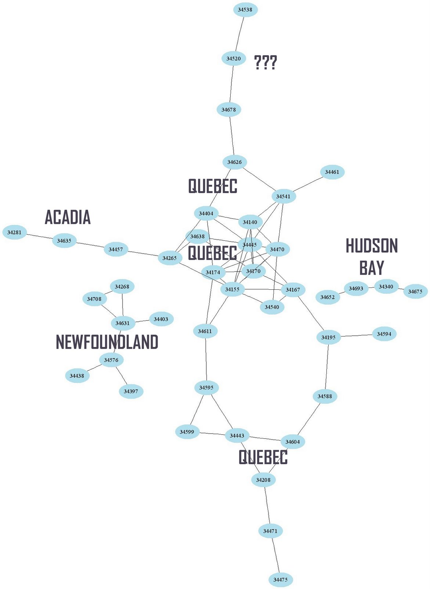
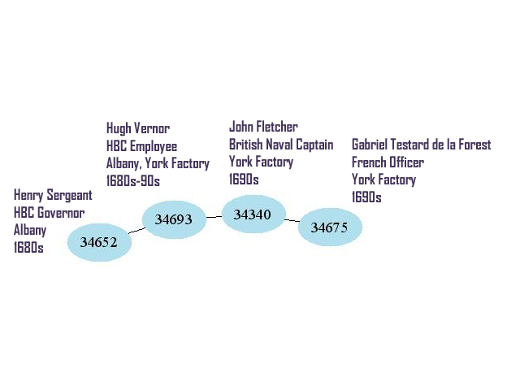
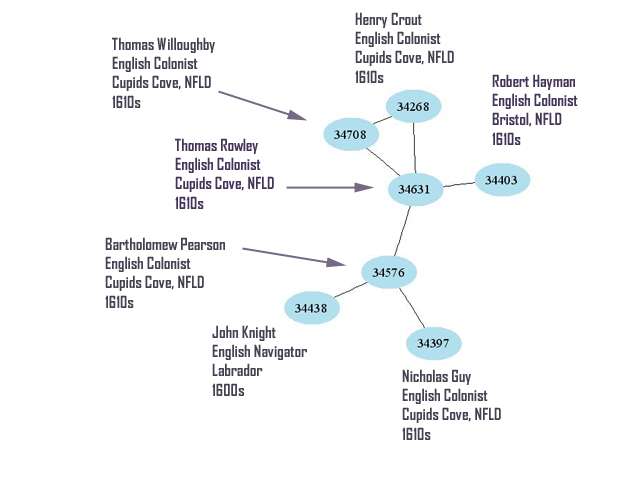
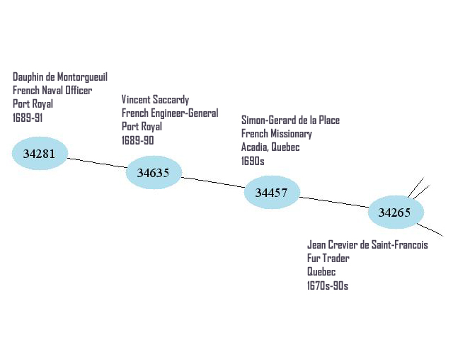
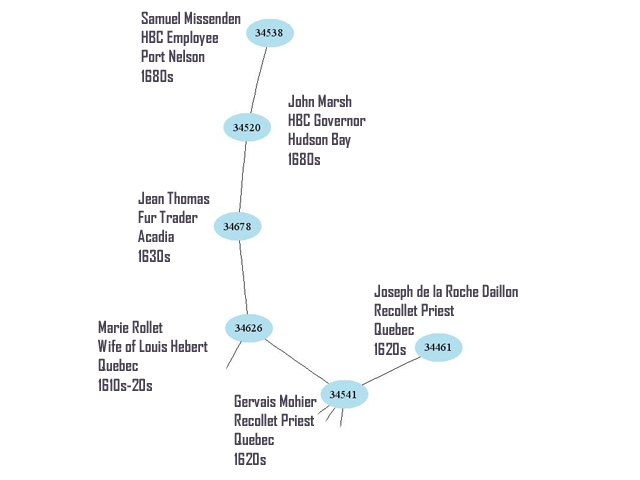
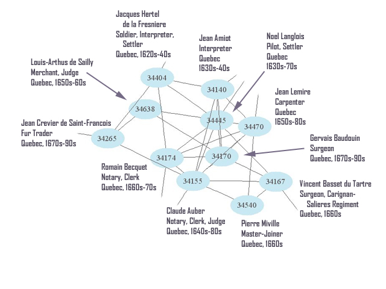
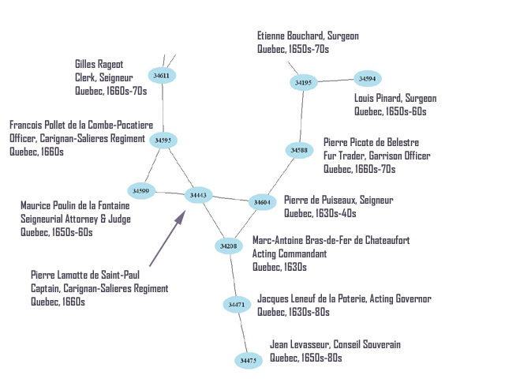

# Clustering with Compression

_June 27, 2007_  
Originally published at `https://digitalhistoryhacks.blogspot.com/2007/06/clustering-with-compression.html`

Last spring I posted short piece about Rudi Cilibrasi and Paul Vitányi's use of compression[^1] as a universal method for clustering ["Clustering by Compression," *IEEE Transactions on Information Theory* 51, no. 4 (2005): 1523-45, PDF[^2]]. The basic idea is that a compression algorithm makes a string shorter by keeping track of redundancies and eliminating them. Suppose you have two strings, *x* and *y*. If there is some overlap between them, then the concatenated and compressed string *xy* should be smaller than the concatenation of separately compressed strings *x* and *y*. (There are more details in my earlier post). Cilibrasi and Vitányi formalized this idea as the Normalized Compression Distance (NCD).  

In my earlier post I selected a handful of entries from the *Dictionary of Canadian Biography[^3]* and submitted them to an open source clustering program that Cilibrasi and Vitányi had provided. I chose the people that I did because I already had some idea of how I would group them myself. The results of the automated clustering were very encouraging, but I hadn't had a chance to follow up with compression-based clustering until now.  

This time around, I decided to do a more extensive test. I wrote a Python program[^4] to randomly select 100 biographies from volume 1 of the *DCB* and compute the NCD between each pair. A second Python program[^5] combed through the output file of the first to automatically create a Graphviz script[^6] that plots all connections below a user-specified threshold. The resulting graph is shown below for NCDs &lt; 0.77.  

  

Looking at different parts of the figure in turn, it becomes clear that this is a remarkably powerful technique, especially considering that the code is very simple and the algorithm has no domain-specific knowledge whatsoever. It knows *nothing* about history or about the English language, and yet it is able to find connections among biographical entries that are meaningful to a human interpreter.  

One isolated chain of biographies consists of people active in Hudson Bay in the late seventeenth century.  

  

A second isolated cluster consists mostly of Englishmen who settled on the coasts of Newfoundland in the early 1600s.  

  

The main cluster is composed almost entirely of people based in various parts of Quebec in the seventeenth century. There is an arm of Acadian settlers, some of whom spent time in Quebec.  

  

There is a somewhat puzzling arm that I haven't really figured out.  

  

And there is the main body of the network and a downward projection that are comprised entirely of seventeenth-century Québécois.  

  

  

One benefit of this method is the incredible speed with which it executes. It took only seconds to calculate 4,950 NCDs; clustering the entire *DCB* would require computing 35,427,153 distance measures and would take less than a day to run on my inexpensive home computer. I'll save that hack for another time.  

Tags: data compression[^7] \| data mining[^8] \| Dictionary of Canadian Biography[^9] \| digital history[^10] \| Kolmogorov complexity[^11] \| visualization[^12]

---

Previous: [Hope, the New Research Strategy](20070619-hope-new-research-strategy.md)  
Next: [Search Refinement with Compression](20070702-search-refinement-with-compression.md)  
[Back to the blog archive](../README.md)

[^1]: `http://digitalhistoryhacks.blogspot.com/2006/03/compression.html`
[^2]: `http://homepages.cwi.nl/~paulv/papers/cluster.pdf`
[^3]: `http://www.biographi.ca/EN/index.html`
[^4]: `http://digitalhistory.uwo.ca/dhh/hacks/ncd-dcb.py.html`
[^5]: `http://digitalhistory.uwo.ca/dhh/hacks/ncd-dcb-graph.py.html`
[^6]: `http://digitalhistory.uwo.ca/dhh/hacks/ncd-dcb-graph.txt`
[^7]: `http://technorati.com/tag/data+compression`
[^8]: `http://technorati.com/tag/data+mining`
[^9]: `http://technorati.com/tag/dictionary+of+canadian+biography`
[^10]: `http://technorati.com/tag/digital+history`
[^11]: `http://technorati.com/tag/kolmogorov+complexity`
[^12]: `http://technorati.com/tag/visualization`
