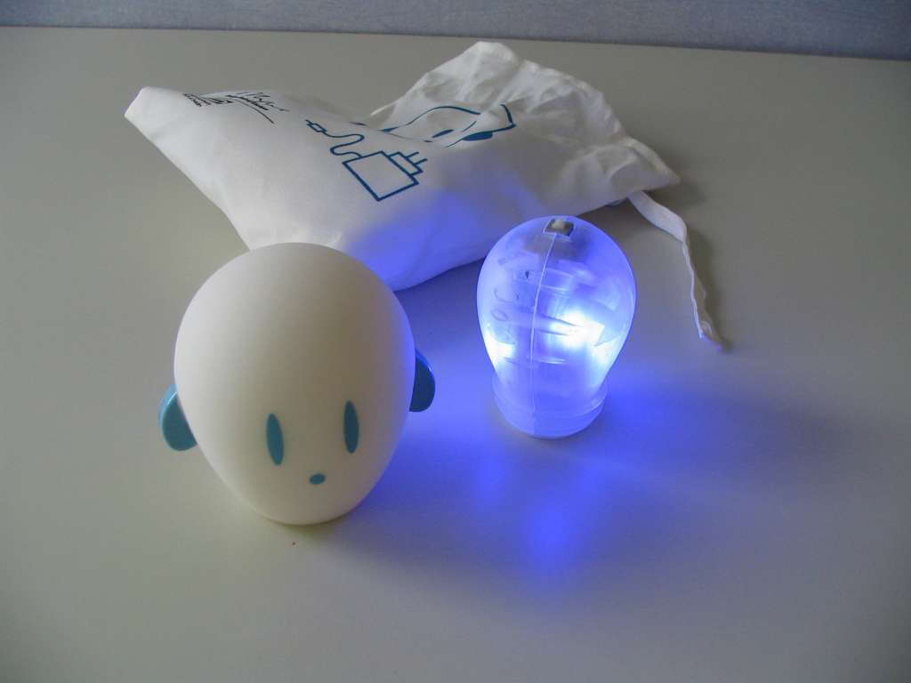
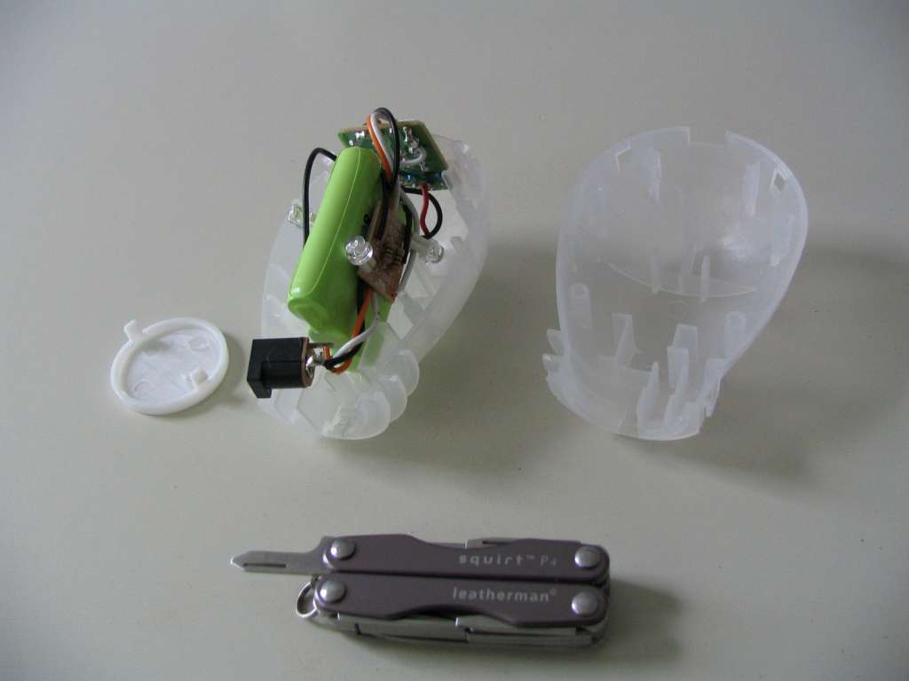
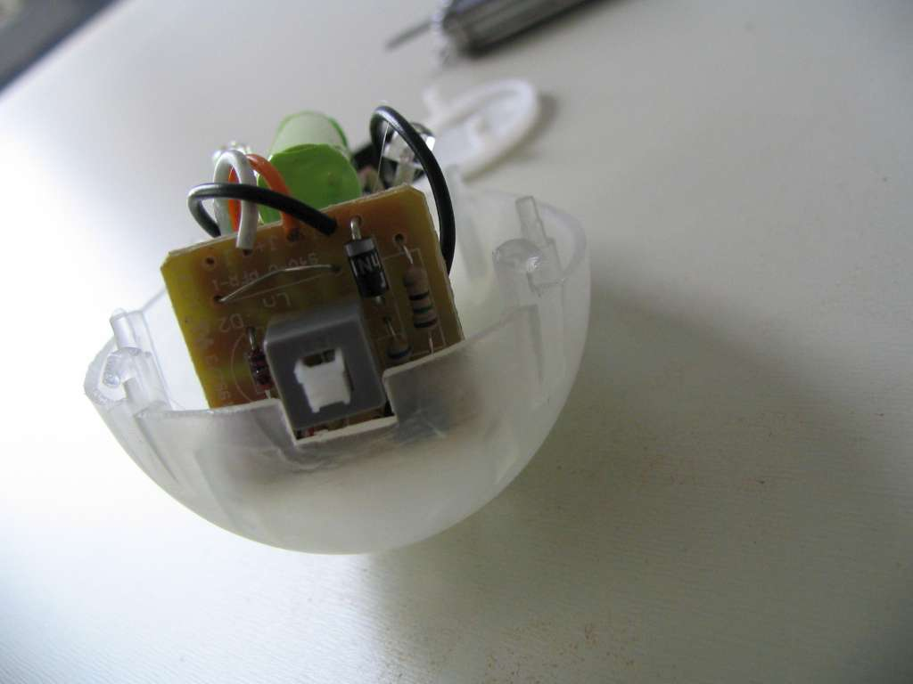
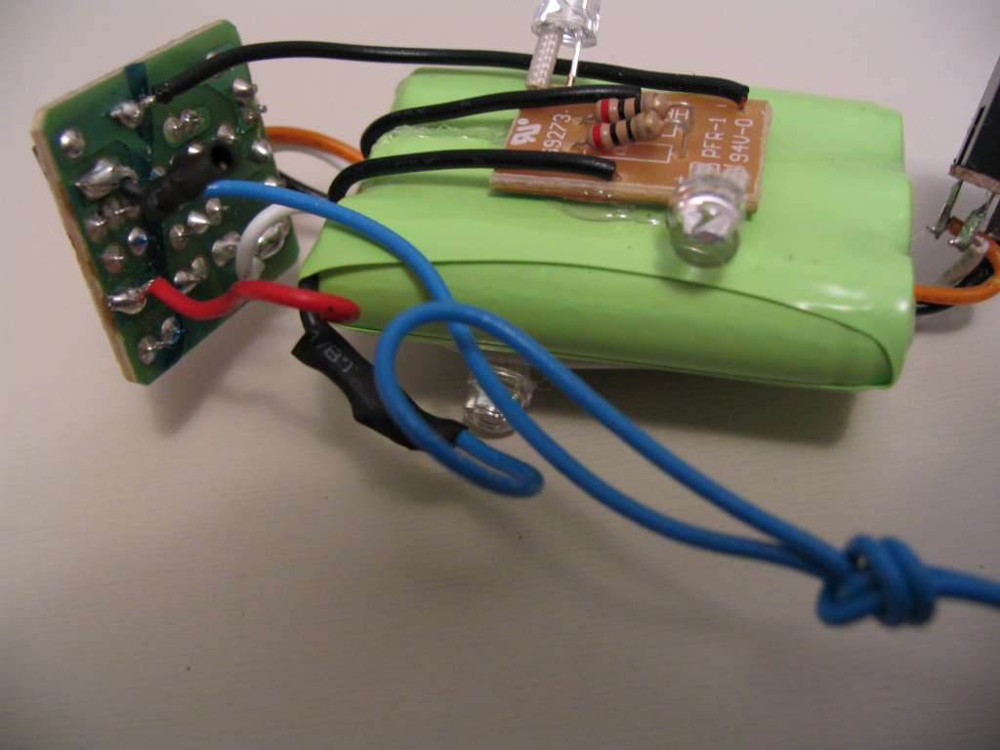
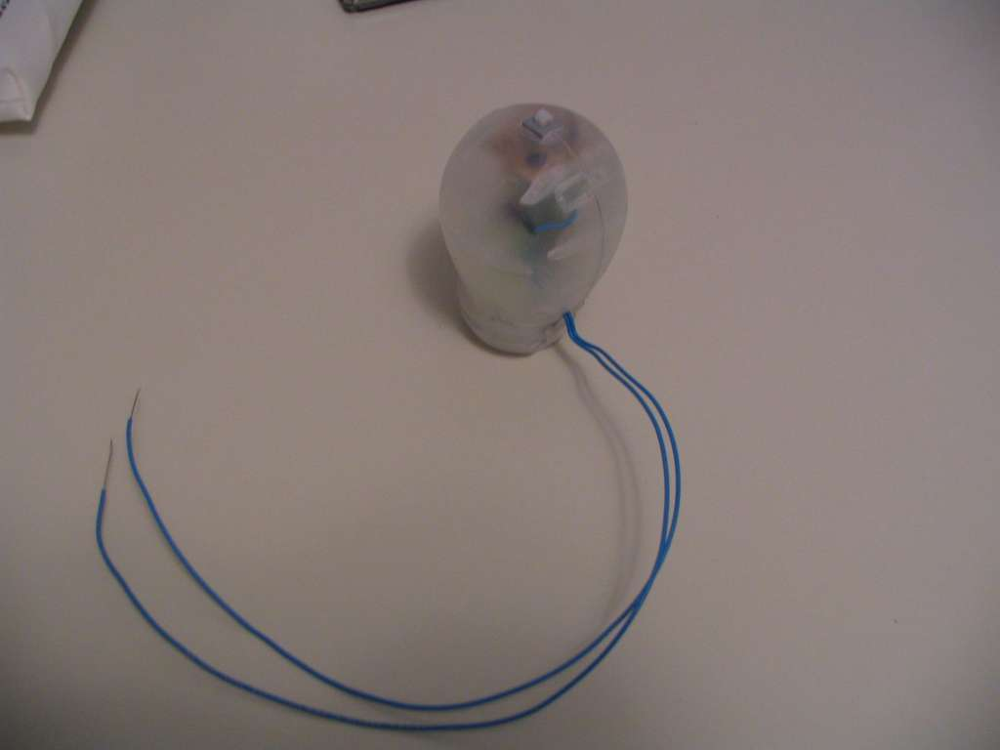
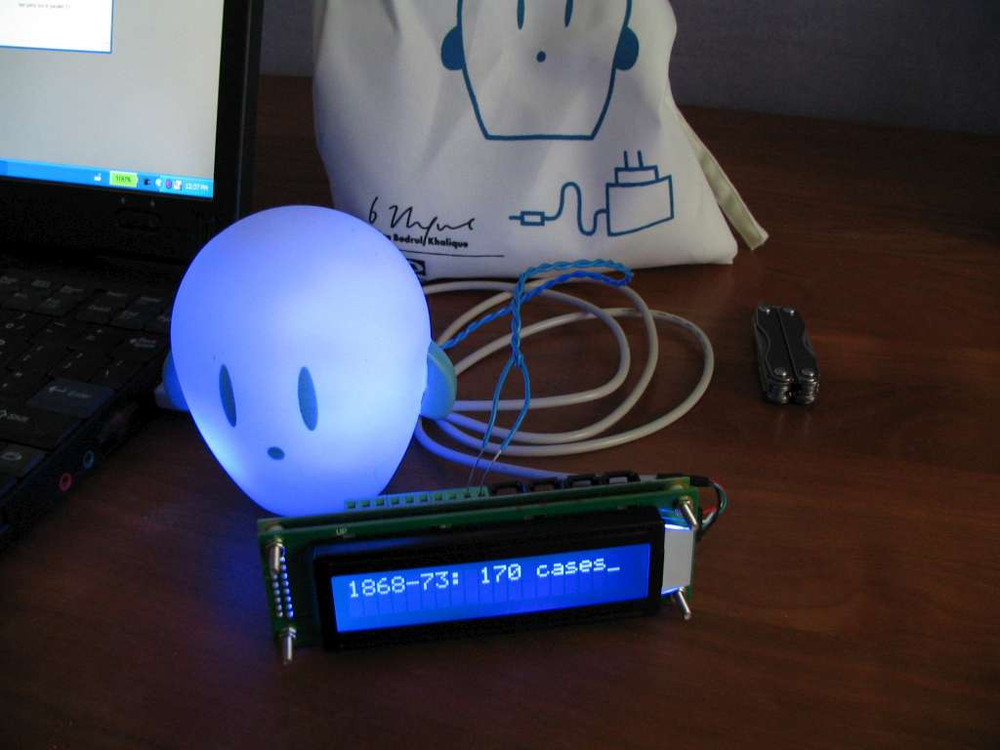

# History Appliances: Spöka

_July 19, 2007_  
Originally published at `https://digitalhistoryhacks.blogspot.com/2007/07/history-appliances-spka.html`

On a recent trip to Ikea I came across this awesome little dude[^1]. They're selling Spöka as "children's lighting," but it was pretty clear to me that it was one hack short of a history appliance. It has a rechargeable battery, so that you can use it without it being plugged in. If you slide off the rubber skin, there is a light-bulb-shaped plastic housing inside.  

  

The designer thoughtfully created a case which can be opened into three parts and reassembled with nothing more than a small screwdriver.  

  

On the top you'll find a simple push button toggle to turn it on and off.  

  

We want to be able to control the light with the computer, however, so I interrupted the power supply by cutting the circuit to the battery and soldering in a pair of wires (the blue ones). I put a bit of heat-shrink tubing over the joints to make them more resilient. I also knotted the wires to provide strain relief where they will emerge from the case.  

  

When the case is reassembled, the wires can be fed out of the top of the hole where the recharging plug goes in.  

  

After you slide the rubber skin back on, you have an LED-lamp that can be controlled by your computer. If you want to wire it up directly, you might use your parallel port, like Eric Wilhelm does for the haunted house controller[^2] in Make volume 3. Instead, I incorporated it into my standard history appliance rig, which uses Phidgets[^3] controlled by Max/MSP[^4].  

For a quick demo project, I created a browser that lets me look through historic newspaper articles about séances from the online Globe and Mail archive. While browsing the stories from a particular time period, Spöka flashes gently in the background, faster if there are a lot of them, slower if not. It provides a nice peripheral feel for the intensity of Spiritualist activity at that point in time.  

  

Tags: ambience[^5] \| hacking[^6] \| history appliances[^7] \| Max/MSP/Jitter[^8] \| phidgets[^9]

---

Previous: [Search Refinement with Compression](20070702-search-refinement-with-compression.md)  
Next: [Import-Export Specialists](20070721-import-export-specialists.md)  
[Back to the blog archive](../README.md)

[^1]: `http://www.ikea.com/ca/en/catalog/products/90064441`
[^2]: `http://www.makezine.com/03/halloween/`
[^3]: `http://phidgets.com/`
[^4]: `http://www.cycling74.com/`
[^5]: `http://technorati.com/tag/ambience`
[^6]: `http://technorati.com/tag/hacking`
[^7]: `http://technorati.com/tag/history+appliances`
[^8]: `http://technorati.com/tag/max+msp+jitter`
[^9]: `http://technorati.com/tag/phidgets`
