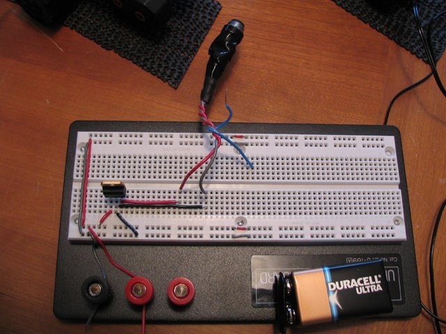
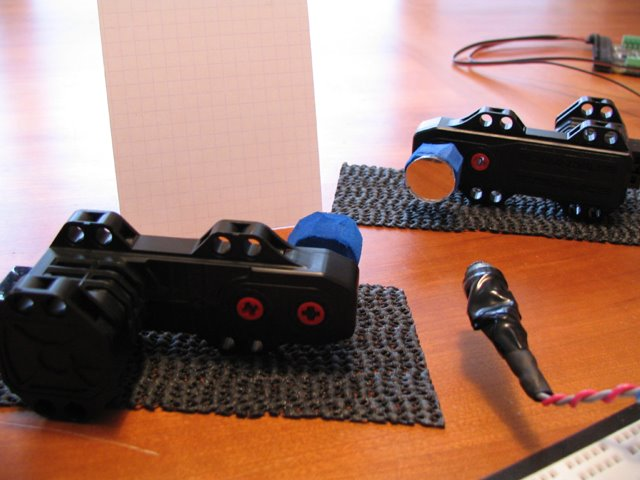
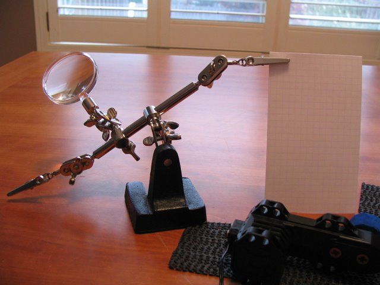
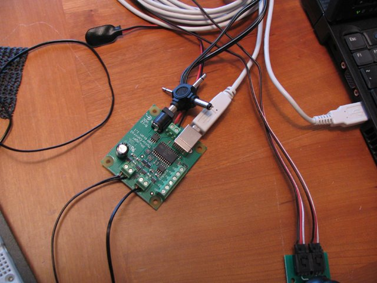
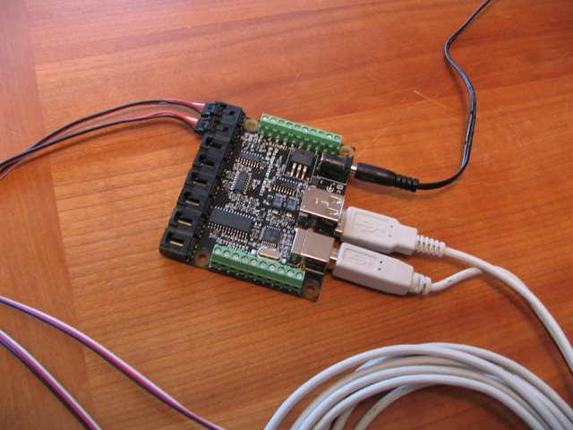
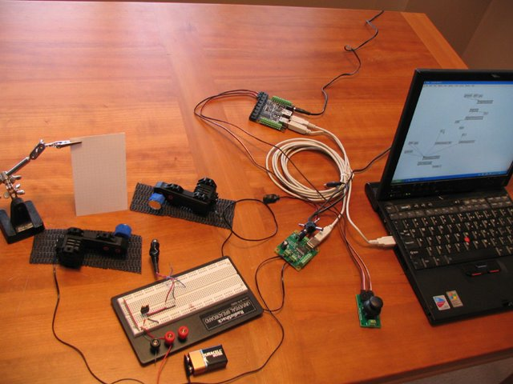
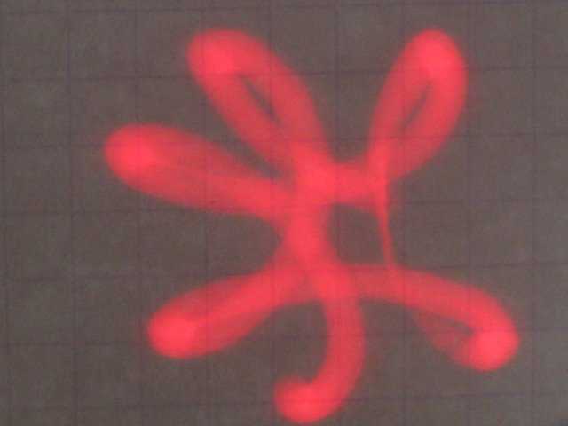
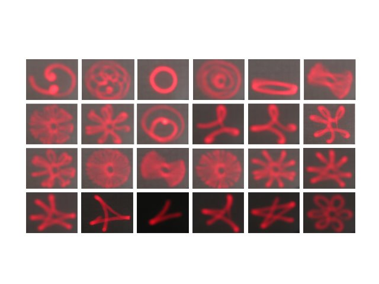

# History Appliances: Laser Spirograph

_November 9, 2007_  
Originally published at `https://digitalhistoryhacks.blogspot.com/2007/11/history-appliances-laser-spirograph.html`

A sure sign of a 1970s childhood is a fond memory of doodling with the Kenner Spirograph[^1] toy. In the back of my mind I've been thinking it would be fun to build something like it into a history appliance. You can already find software versions[^2] online, but I wanted something that could be used at the periphery, rather than the focus, of attention. On a recent trip to Active Surplus[^3] in Toronto I realized I could build a version quite cheaply. So here it is: a little too thrown together even to call a hack, this is really a kludge[^4].  

I started by cutting a $1 laser pointer out of its casing and soldering some wires to it so I could switch it on and off electronically. Here it is on a breadboard with a 5v voltage regulator.  

  

The laser shines on a mirror that is crazy-glued to a cylindrical piece of dense foam and mounted on the shaft of a motor. I used Lego motors because I had a pair of them. The reflection bounces off another mirror, similarly mounted, and is projected on to a screen made from a 3x5 card. The motors tend to slip around when they are running so I put a rubber mat under each.  

  

  

The motors are controlled by pulse width modulation, using a Phidgets MotorControl LV[^5] board. I used a wall wart to supply 9v for the motors.  

  

To be able to fiddle with the speed of each motor, I used the Phidgets Interface Kit[^6], the mini joystick[^7] and a Max/MSP[^8] patch.  

  

The whole setup looked like this.  

  

With the motors both running, the dot of the laser pointer is perturbed by first one rotation, then the next, tracing out a familiar spirograph-style image.  

  

As you vary the speed and direction of rotation for the two mirrors, you get a range of different patterns.  

  

To demonstrate, I used the joystick to vary the parameters of the system. In an application, it would be hooked up to streaming data instead. Groovy!  

Tags: ambience[^9] \| hacking[^10] \| history appliances[^11] \| nostalgia[^12]

---

Previous: [Seams and the Suspension of Disbelief](20071028-seams-and-suspension-of-disbelief.md)  
Next: [How To: Make a Museum Exhibit Mockup with Free Tools, Part 1](20071112-how-to-make-museum-exhibit-mockup-with.md)  
[Back to the blog archive](../README.md)

[^1]: `http://www.journalofantiques.com/Jan07/playing_around.html`
[^2]: `http://www.math.psu.edu/dlittle/java/parametricequations/spirograph/SpiroGraph1.0/index.html`
[^3]: `http://www.activesurplus.com/`
[^4]: `http://catb.org/jargon/html/K/kluge.html`
[^5]: `http://www.phidgets.com/products.php?product_id=1060`
[^6]: `http://www.phidgets.com/products.php?product_id=1018`
[^7]: `http://www.phidgets.com/products.php?product_id=1113`
[^8]: `http://cycling74.com/products/maxmsp`
[^9]: `http://technorati.com/tag/ambience`
[^10]: `http://technorati.com/tag/hacking`
[^11]: `http://technorati.com/tag/history+appliances`
[^12]: `http://technorati.com/tag/nostalgia`
