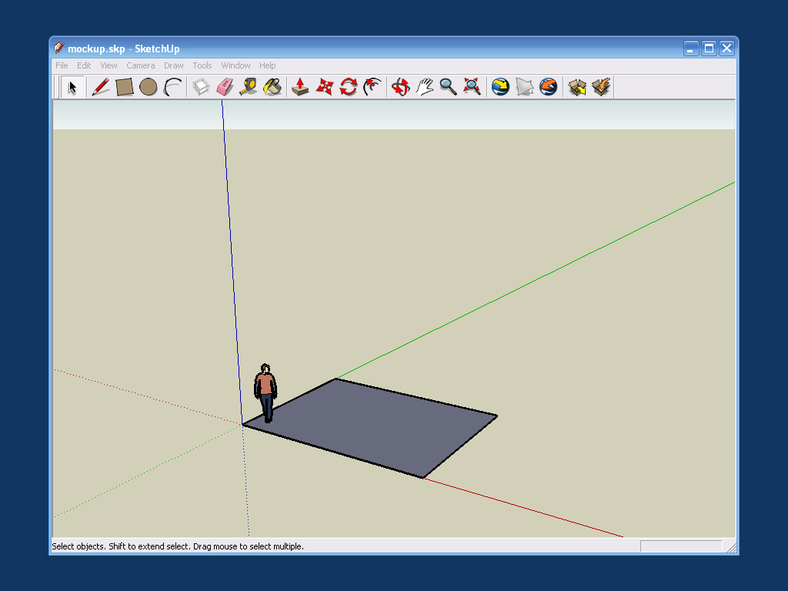
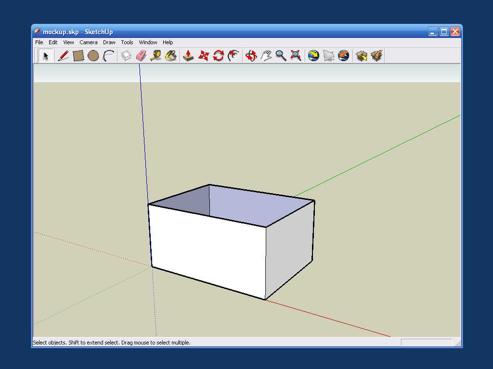
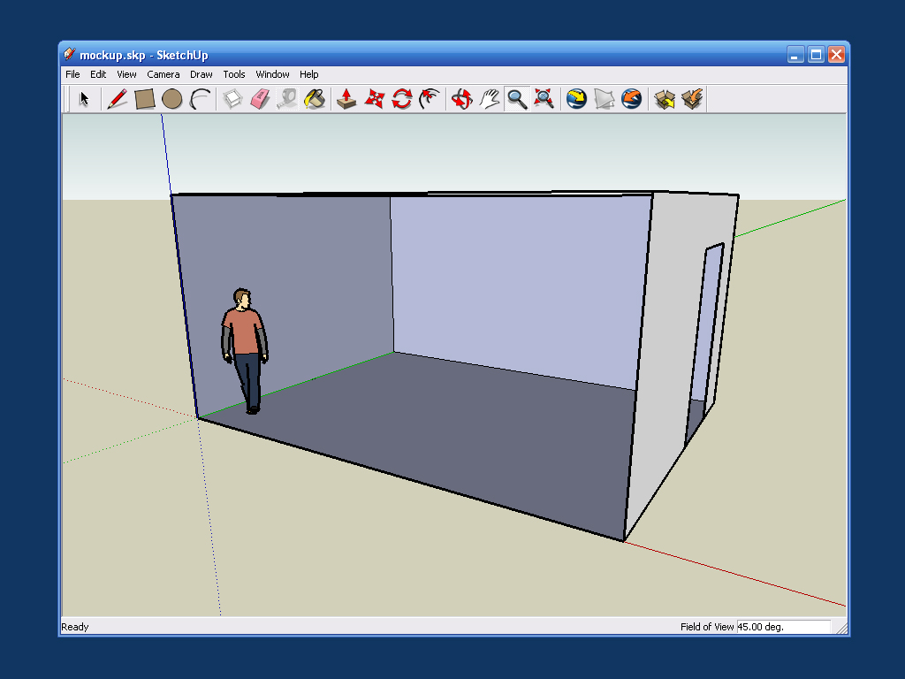
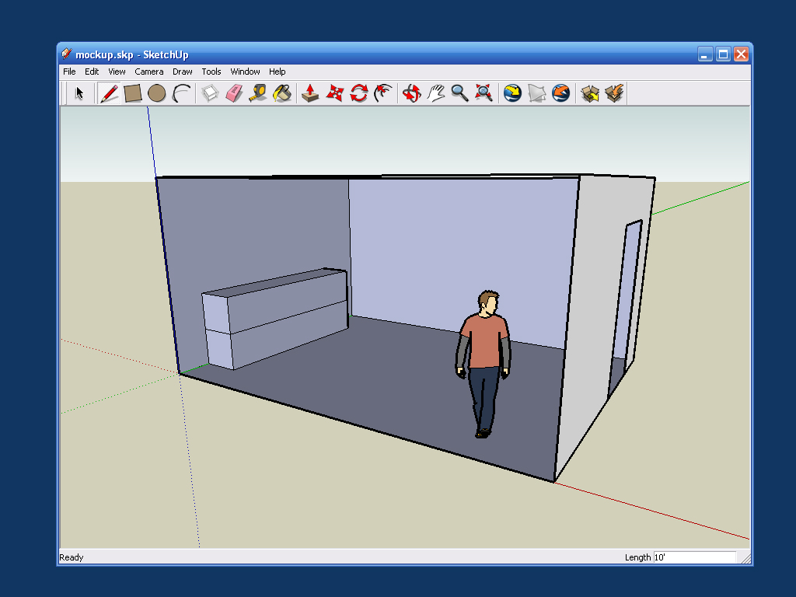
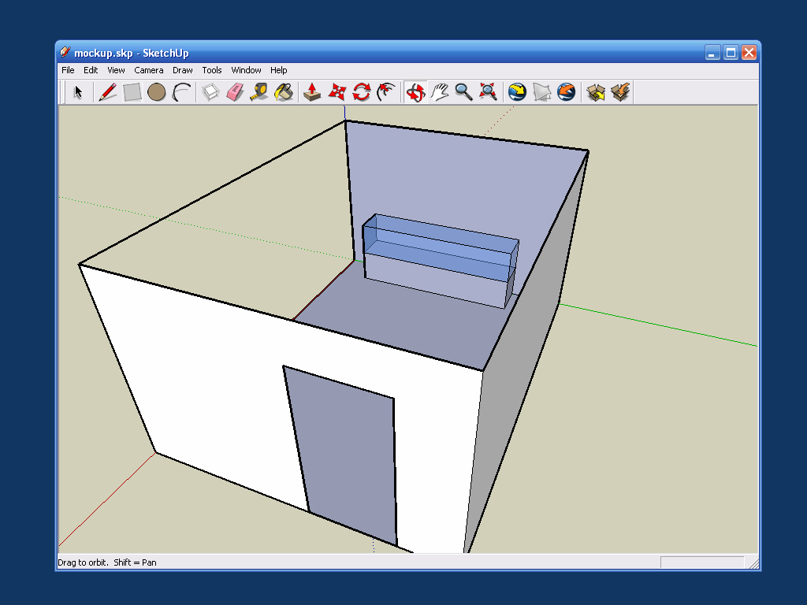
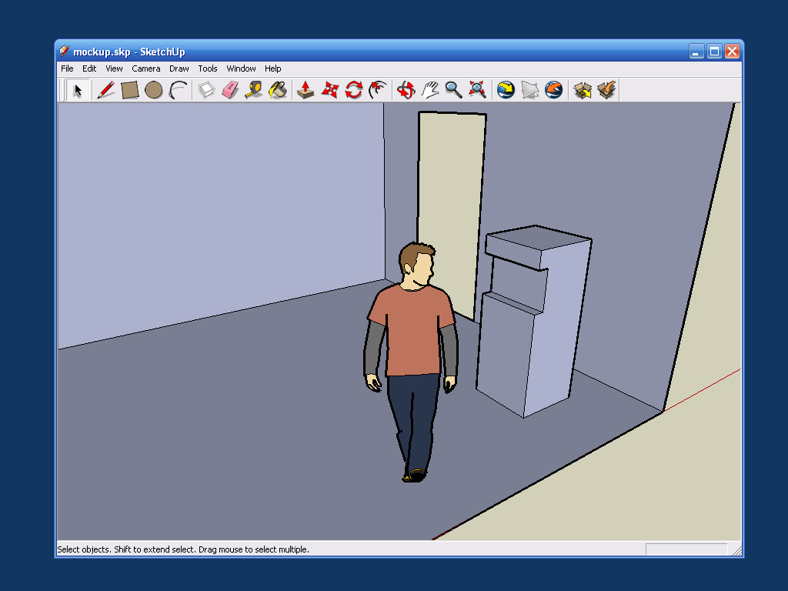
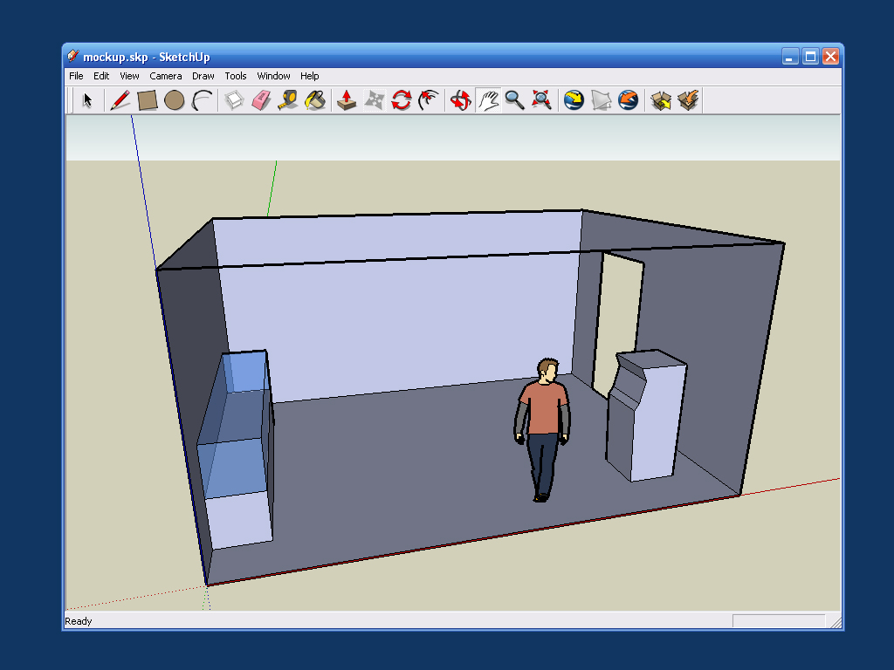
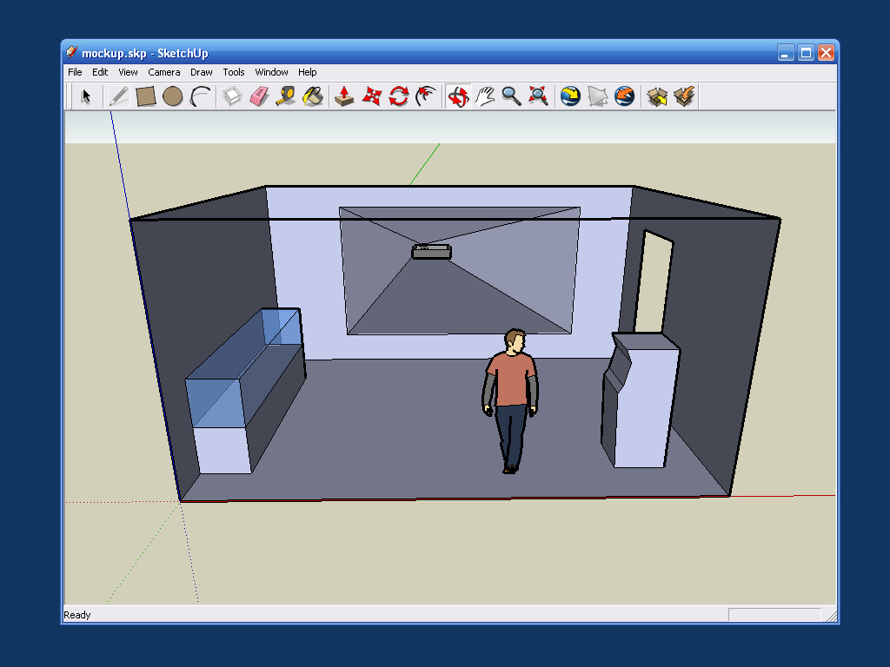
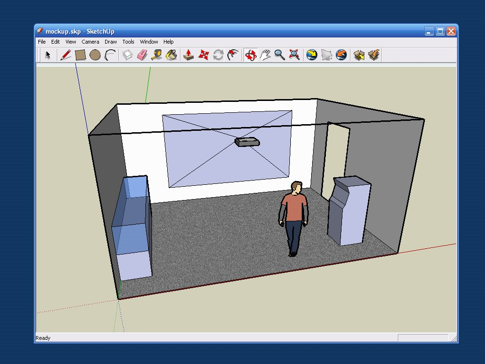

# How To: Make a Museum Exhibit Mockup with Free Tools, Part 1

_November 12, 2007_  
Originally published at `https://digitalhistoryhacks.blogspot.com/2007/11/how-to-make-museum-exhibit-mockup-with.html`

Many people who make their way into public history find themselves in the position of having to impress a potential client without necessarily having many resources to do so. They may need to submit a proposal for a museum exhibit, for example, without being able to afford the services of a graphic designer. While it's always nice to get professional assistance, it's also nice to know that you can use freely available tools to create something a little slicker than a sketch on the back of an envelope. In this post and the next, I'll show you how to create a simple 3D model of an exhibit that you can build into a proposal or presentation. For the purposes of this demonstration, I want to focus on the digital tools, so the exhibit that I describe will be completely made up.  

To follow along, you need to download and install two freely available programs, Google SketchUp 6[^1] and The GNU Image Manipulation Program (GIMP[^2]). Both are available for Windows and Macs. Here I will give instructions for Windows; I assume the commands can be translated for Macs relatively easily.  

First, you have to establish the dimensions of both your potential output and your exhibit space. Graphics files are typically described in terms of width, height and resolution. A common size for presentation on screen is 1024 pixels wide, by 768 pixels high, with a resolution of 72 dots per inch (dpi). If you want a larger or smaller image, keep the same resolution and the same 4:3 aspect ratio of width to height. Common sizes are 1600 x 1200 pixels, 1400 x 1050, 1024 x 768, 800 x 600, 640 x 480, 320 x 240 or 160 x 120. Newer monitors may have a different aspect ratio such as 5:4 or 16:9, but you are probably safest sticking with 4:3 unless you know what kind of monitor or projector your presentation will appear on.  

If you plan to print your image on paper, you need to create it with a higher resolution, typically at least 240 to 300 pixels per inch (ppi). One of the challenges of working with graphics is that something that looks good on your screen can be underwhelming when you print it out, especially if you are trying to make a poster. Here I will assume we are creating something to be output on a computer screen.  

Try to get blueprints and photographs of the exhibit space if you can. If not, make sure to get enough measurements that you can reconstruct the space. For my made-up example, I'm going to say that my space is 15' x 20' with a 10' ceiling. There is a 4' x 8' entrance in one of the 15' walls, and where one of the 20' walls would be there is actually an opening leading into another gallery. I have a ceiling mounted LCD projector to display on the 20' wall, and a display case (10' long x 4' high x 2' deep) along the 15' wall without the door. There will also be a free-standing kiosk with a 2' x 2' footprint that is 5' high, which I can move to an appropriate location in the room.  

Given the dimensions of the space, we can use SketchUp to create a rudimentary 3D model. Start by using the Rectangle tool to draw the floor. To get the dimensions right, click on the origin and move the cursor into the plane, drawing a rectangle. You will see the dimensions in the lower right hand corner of the screen as you move the cursor. Type in *20', 15'* and press Enter. The program should respond by drawing your floor. You can check your work with the Tape Measure tool to make sure the dimensions are right. Your mockup should look like this:  

  

Now we want to create the basic volume of the space. Choose the Push/Pull tool (the one that looks like a block with a red arrow coming out the top), select the floor, hold down on the left mouse button and pull up a little bit. A cube should extrude upwards. Type in the distance (*10'*) and press Enter. We'll want to be able to see into the space, so use the Arrow to select the top face of the cube, right click and choose Erase. If everything worked, you should see something like this:  

  

Since one of the 20' walls opens into another gallery, we can erase it, too. Use the Rectangle tool to draw a 4' x 8' entry way in one of the 15' walls and use Move to slide it into the right position if necessary. Use the Arrow to select the door, right click and Erase it. Click the Zoom to Extents tool (a magnifying glass with four red arrows) and then type *45* to get a 45-degree field of view. When you press Enter the mockup should look something like this:  

  

Now we want to create our display case. Unfortunately, the little dude who shows up by default is standing in the way. (His name is "Bryce.") Use the Arrow tool to select Bryce and then use Tools->Move to drag him out of the way. Now use the Rectangle tool to draw the 10' x 2' footprint of the display case along the wall. Use the Push/Pull tool to extrude it to a height of 4'. Since the top 2' of our display case is made of glass, we use the Pencil tool to draw a line around the midpoint of the case. The mockup now looks like this:  

  

Next we use the Orbit tool to rotate the image around so that we can see the far side of the display case. Using the Paint tool, paint the top surface, and the left, front, and right top halves with transparent blue glass. Now that you can see into the case, it is obvious that we will need an internal platform to place artifacts on. Draw one with the Rectangle tool.  

  

Next we create the kiosk. We use the Orbit and Zoom tools again to get a good view of where we want to put it. Draw the 2' x 2' footprint with the Rectangle tool, and then extrude it to a height of 5' with the Push/Pull tool. My imaginary kiosk looks a bit like a classic arcade-style video game. We use the Rectangle tool to draw a Golden Section on the front face, then the Push/Pull tool to push it in about 4".  

  

This next bit is hard to describe, but easy enough once you get the hang of it. By selecting the horizontal lines on the front of the kiosk, we can use the Move tool to push them in or out gently, thus sculpting the front. If you do something too drastic, you can always Undo it. When finished, mine looked like this:  

  

Next we want to place our LCD projector on the ceiling and indicate where the image will be projected. Rather than creating a projector model ourselves, we go to the Google 3D Warehouse and search for "projector". The one created by Rothmatic[^3] looks like what I had in mind, so we save it to disk and import it into the drawing.  

Use the Scale tool to make the projector the right size. Then Move it into the center of the ceiling and Rotate it to the right orientation. In this demonstration, I've just eyeballed it, but for a real exhibit you would want to know where the projector would be mounted, and how large and where exactly the image would be cast. You would want to make sure that most visitors wouldn't walk through the beam. You'd also have to worry about ambient lighting being high enough for comfort but not so high as to drown out the projected image. In the interests of pedagogy, however, we're making this up and simplifying as we go along. Use the Rectangle tool to draw the projected image on the wall, and the Pencil tool to draw lines from each corner of the projected image back to the projector lens. If all your lines connect, you will end up with a pyramid-shaped solid, as shown in the next image.  

  

Now use the Arrow tool to select each face of the pyramid in turn, right-click and Erase them. Use the Paint tool to make the walls off-white, and the carpet gray. The final model should look like this:  

  

We now have a basic 3D model which we can use to convey an impression of how the exhibit space will look. If you'd like to load the model into SketchUp and play with it, a copy is here[^4]. In the next part, we'll generate some screenshots of our space, and load them into The GIMP for further manipulation.  

Tags: digital history[^5] \| public history[^6]

---

Previous: [History Appliances: Laser Spirograph](20071109-history-appliances-laser-spirograph.md)  
Next: [How To: Make a Museum Exhibit Mockup with Free Tools, Part 2](20071113-how-to-make-museum-exhibit-mockup-with-13.md)  
[Back to the blog archive](../README.md)

[^1]: `http://sketchup.google.com/`
[^2]: `http://www.gimp.org/`
[^3]: `http://sketchup.google.com/3dwarehouse/details?mid=b68f3ebb2a34146ea609863dc598b66d&prevstart=0`
[^4]: `http://digitalhistory.uwo.ca/dhh/images/mockup.skp`
[^5]: `http://technorati.com/tag/digital+history`
[^6]: `http://technorati.com/tag/public+history`
