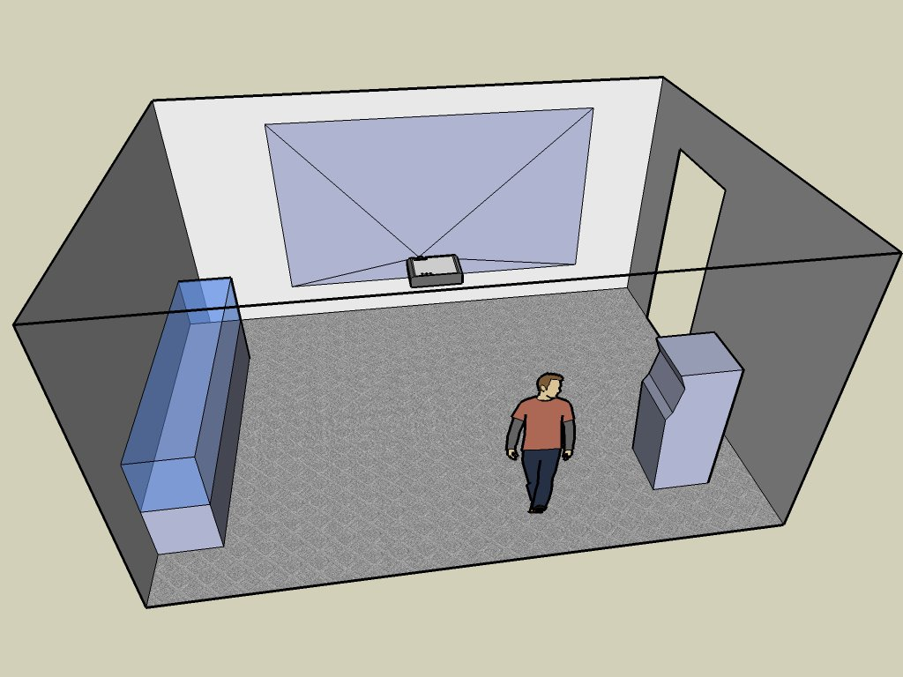
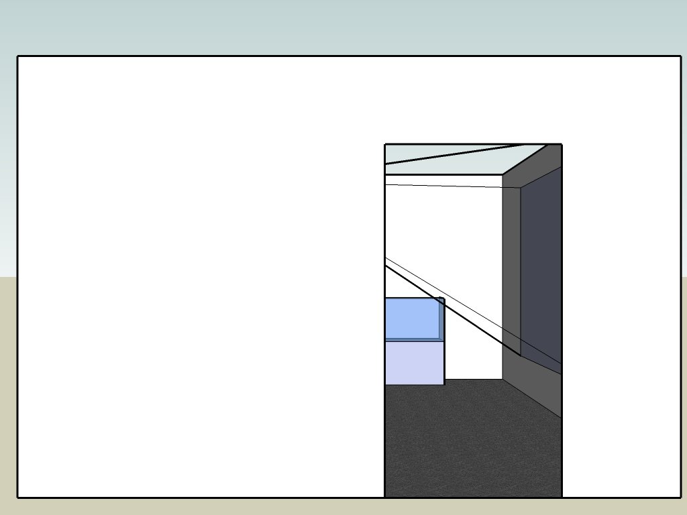
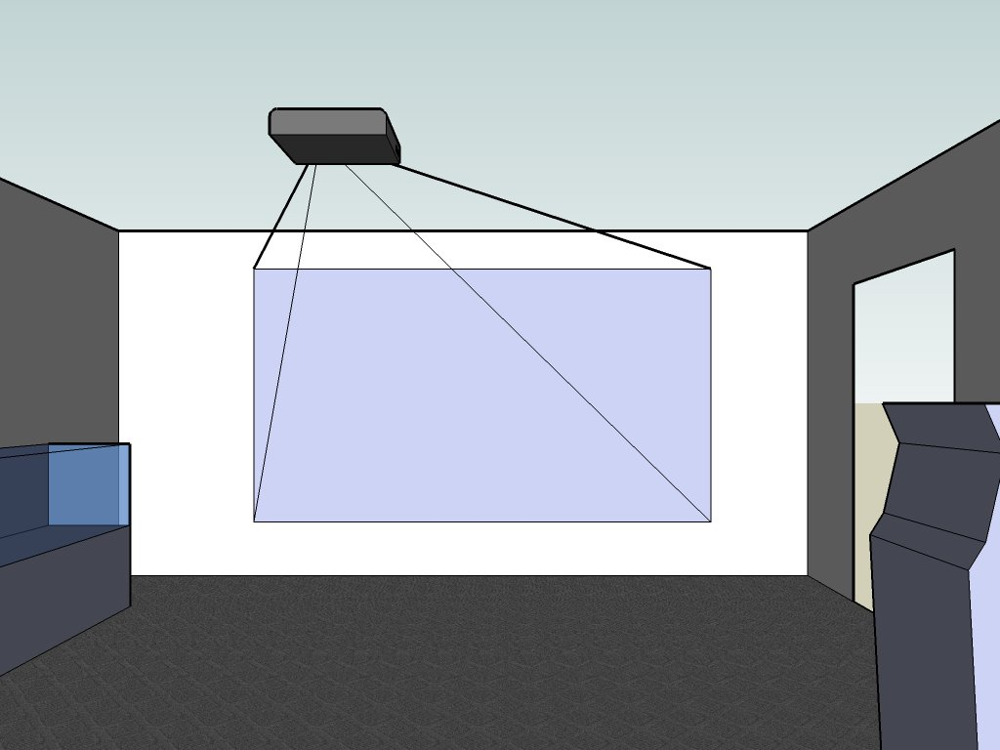
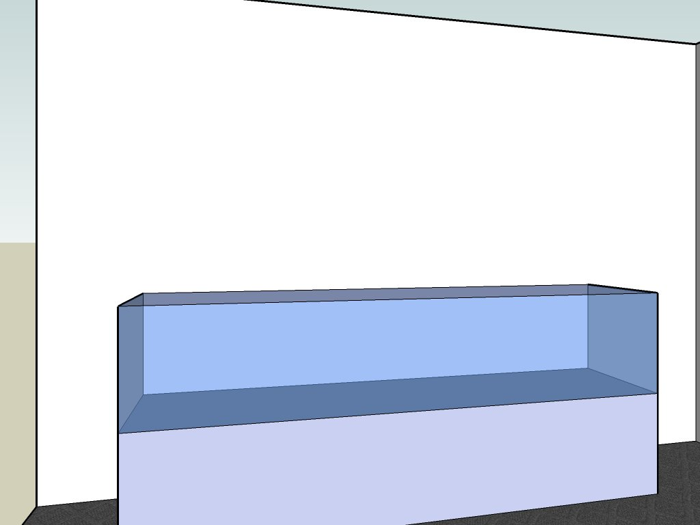
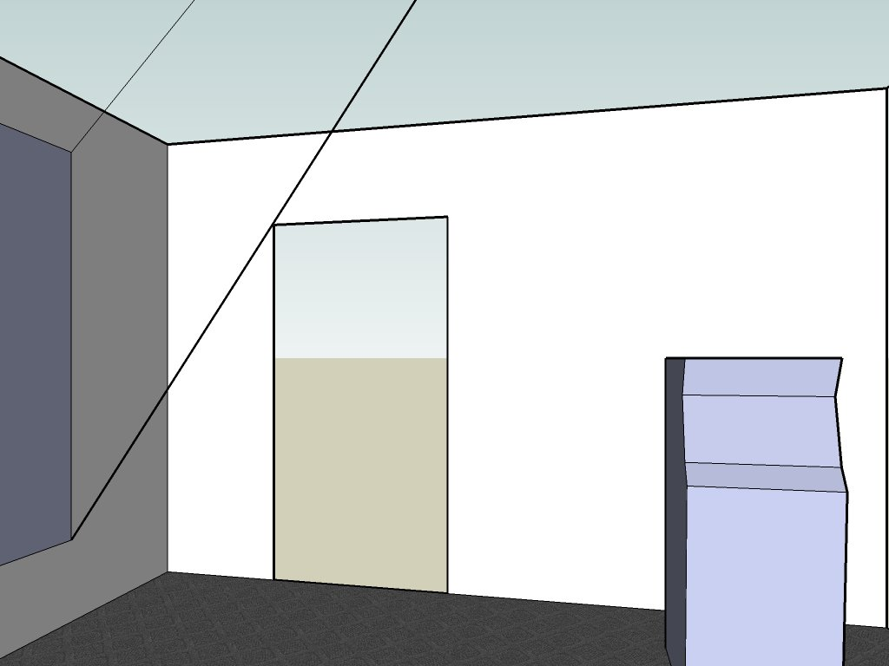

# How To: Make a Museum Exhibit Mockup with Free Tools, Part 2

_November 13, 2007_  
Originally published at `https://digitalhistoryhacks.blogspot.com/2007/11/how-to-make-museum-exhibit-mockup-with_13.html`

In the first part[^1] we made a simple 3D mockup of an imaginary museum exhibit using the freely available Google SketchUp[^2] tool. The great thing about 3d modeling is that it allows you to explore a space from various vantage points. For our purposes, two points of view are particularly important. First, how can we best show off this space to a potential client? We want to find views that can convey the unity of the big picture, and ones that emphasize individual highlights. The second collection of vantage points that we have to consider, of course, are those of the museum visitors. This means figuring out the most likely path through the space and the places where someone is probably going to stop, to look at something or to read a panel. The professional version of SketchUp (the one that you pay for) allows you to create animated walk-throughs which can be particularly convincing.  

Here we'll stick with free tools, so we are going to think of our next step as creating a storyboard. Our goal is to turn a full three-dimensional world into a linear narrative and an accompanying series of two-dimensional still shots, not something that most historians are trained to do. I've found books like *Understanding Comics[^3]* and *Film Directing: Shot by Shot[^4]* to be very useful resources for the process of storyboard design.  

Start SketchUp and load the exhibit mockup[^5]. Start The GIMP[^6] while you're at it. For the exhibit proposal that we're making, we are going to want one shot that shows the whole space at a glance. This should be elevated enough so that it won't be confused with any realistic vantage point within the exhibit. We want to suggest a microcosm, and, by implication, a powerful viewer. In SketchUp, use the Orbit tool to get a view into your space that shows the interior walls and is looking down from a relatively steep angle. Now choose the Zoom tool, type *55* and press Enter to get a wide field of view. Click Zoom to Extents so that your space fills the screen. You can try adjusting angles until you get a view you like.  

Next you are going to output some 2D pictures of your space as JPEG files. JPEG images are compressed, which means that they are small and easy to work with, and usually of good enough quality for online presentation. For archival work, or if you were planning to print your images, you would probably use Tagged Image Files (TIF) instead. The TIF format retains a maximum amount of information, which means that the images are often very large but of high quality.  

If you are happy with your view, use File->Export->2DGraphic to create a JPEG. Use the Options button to set the image size so that (a) the width is 1024 pixels and the height is a little greater than 768 pixels, OR (b) the height is 768 pixels and the width is a little greater than 1024 pixels. What you don't want is a situation where the width is less than 1024 or the height less than 768 or both. You can monkey around with this until you see what I mean. Save your JPEG and then go to The GIMP and open it up. Ignore any warning messages you get; the software will do the right thing with your file.  

In The GIMP, choose Image->CanvasSize. The width and height of the file are shown at the top, joined together on the right by a little chain. If you try to change one value, the other changes automatically, because the two values are chained together. Click on the Chain to break the link. Set the width to 1024, the height to 768 and click Resize. Now choose File->Save and click Export. This will save your file with the new dimensions. Use File->Close to close the image in The GIMP. Go out to Windows, right-click on your file and choose Properties. Click the Summary tab, and the Advanced button. It should confirm that your file is 1024 x 768 with 72 dpi. It is a good idea to get in the habit of keeping track of the properties of your image files. My first view looks like this:  

  

We now want to generate some views that are more representative of what the visitor would see. First, we want a shot of the view from outside the entrance. Choose Camera->StandardViews->Right and export a JPEG of the view. Mine looks like this:  

  

As the visitor enters, I'm going to assume that his or her attention is drawn first to the projected image. (At this point Bryce might be getting in the way. You can try moving him around the space and orienting him appropriately, or simply drag him out of the way, which is what I did.) Choose Zoom and set the field of view to 65 degrees. Then choose Camera->StandardViews->Front. We want to give more of a feeling of immersion with this view, so choose Camera->Walk, put the cross hairs on the front edge of the carpet and click. Then you can use the UpArrow on the keyboard to move into the scene at the right eye level. When you're happy export a JPEG. Mine looks like this:  

  

Next we want to show a view of the display case. Click on the carpet near the kiosk, and use the UpArrow and LeftArrow on the keyboard to 'walk' around the scene until you get a good view. When you've got it, export a JPEG. Here's mine:  

  

Finally, I'm imagining that the visitor will check out the kiosk before moving into the next gallery. Continue to use the Walk tool to move around the scene until you get a good view looking back at the kiosk. Export a JPEG. Mine looks like this:  

  

We now have five images of our space to use in the presentation. At this point they are still quite plain. In the next part we will use The GIMP to modify these images to convey more of our vision for the exhibit.  

Tags: digital history[^7] \| public history[^8]

---

Previous: [How To: Make a Museum Exhibit Mockup with Free Tools, Part 1](20071112-how-to-make-museum-exhibit-mockup-with.md)  
Next: [How To: Make a Museum Exhibit Mockup with Free Tools, Part 3](20071113-how-to-make-museum-exhibit-mockup-with-8511.md)  
[Back to the blog archive](../README.md)

[^1]: `http://digitalhistoryhacks.blogspot.com/2007/11/how-to-make-museum-exhibit-mockup-with.html`
[^2]: `http://sketchup.google.com/`
[^3]: `http://www.amazon.com/Understanding-Comics-Invisible-Scott-Mccloud/dp/006097625X/`
[^4]: `http://www.amazon.com/Film-Directing-Visualizing-Concept-Productions/dp/0941188108/`
[^5]: `http://digitalhistory.uwo.ca/dhh/images/mockup.skp`
[^6]: `http://www.gimp.org/`
[^7]: `http://technorati.com/tag/digital+history`
[^8]: `http://technorati.com/tag/public+history`
