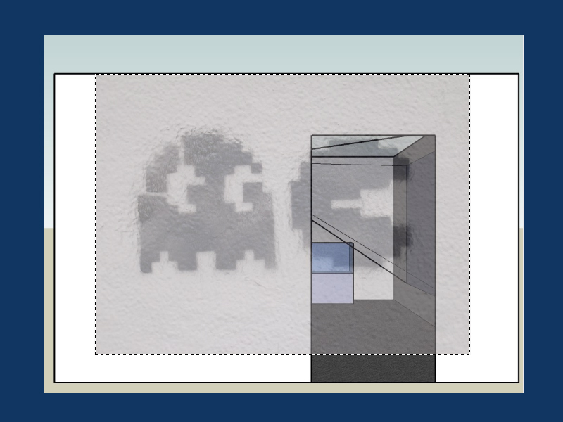
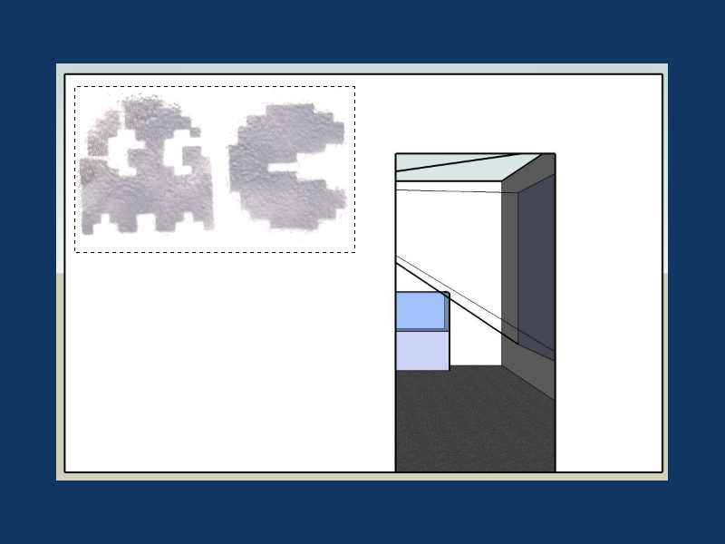
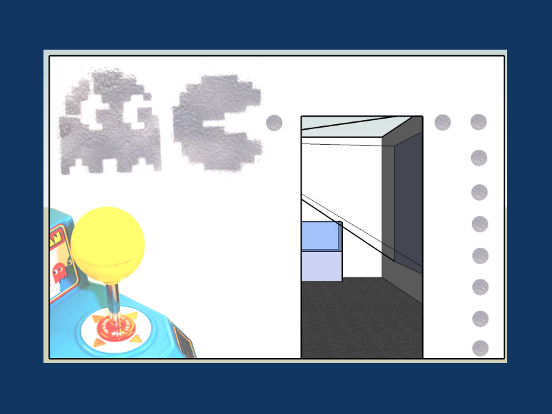
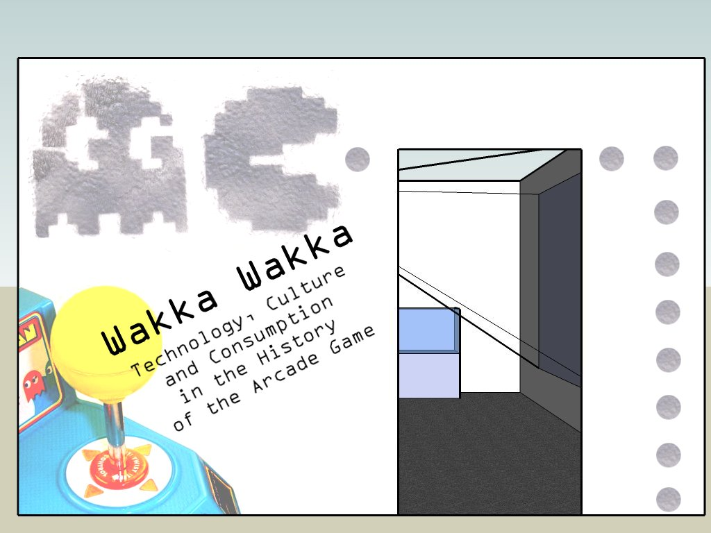

# How To: Make a Museum Exhibit Mockup with Free Tools, Part 3

_November 13, 2007_  
Originally published at `https://digitalhistoryhacks.blogspot.com/2007/11/how-to-make-museum-exhibit-mockup-with_8511.html`

In the previous parts (1[^1], 2[^2]) we built a 3D model of an imaginary museum exhibit in Google SketchUp and then created some views of it to use in a presentation to potential clients. Those views showed the geometry of the exhibit space, but not much more. Now we are going to use The GNU Image Manipulation Program[^3] (GIMP) to modify one of these views to create a more compelling vision of what the exhibit could be like.  

The museum exhibit that I'm using for this demonstration is entirely made up. I'm going to say that it is about video arcade games in the late twentieth century, with a focus on technology and culture. Since I don't have any images or artifacts, I'm going to have to use ones that are already online. I don't want to violate anyone's copyright, so I need to search for images that have a Creative Commons[^4] license. I search Flickr for photographs of "video game", "arcade game" and other likely terms, and save links to ones that look promising.  

Software packages like The GIMP, or its commercial cousin Adobe Photoshop, allow you to manipulate almost every aspect of an image and to combine multiple images into one by compositing layers. Think of this as working with a stack of transparencies. You can manipulate different pieces of your image on different layers, and when you are ready to produce a final image, you merge them all together. In its simplest form, this compositing process stacks up the images and figures out what is visible from the top and what isn't. More sophisticated techniques allow you to use the contents of one layer to influence another. This will become more clear as we go along.  

Let's start with the image of the entrance[^5] that we created last time. We open the file in The GIMP. I also want to use an image of a PacMan graffito[^6] from Barcelona, so open that in The GIMP too. Starting with the graffito, use Select->All and Edit->Copy to put a copy on the clipboard. Now go to the entrance image and use Edit->PasteInto to plunk it into the middle. It doesn't look very good at the moment, but don't worry about that. If you look at the Layers window in The GIMP you will see that you now have a Background layer (the image of the entrance) and a new Floating Layer on top of it. If you use your cursor to select the floating layer, and drag the Opacity slider to the left, you will see what you just pasted start to become transparent, so you can see the underlying layer through it. With 50% opacity, the two images look like this:  

  

What we want to do is move the two little figures left and up, scale them appropriately, and blend them so they look more like they are painted on the wall near the entrance. First use the Scale tool on the graffito layer and make it about 67% of its original size. Then Move it into the place where you want it. Next use the Crop tool to trim the space around the two figures. Check the "Current layer only" box, draw a rectangle around the figures, and press Enter. If you make a mistake, undo it. Go to the Layers window, and where it says Mode: Normal, choose Mode: Hard Light. Your image should look something like this now:  

  

Next we want to create some "pills" (the kind that Pac Man ate) and we want the texture to match our two monsters. Go to the window with the original grafitto and Select a circular region of painted wall, copy it to the clipboard. Return to the image we're working on, create a New Layer, and use the PasteInto command to paste eight or nine copies of the circle into it. As you paste each, use Move to arrange them in a row of pills running down the right side of the entrance way. Adjust the opacity and mode to match the two monsters. My version now looks like this.  

  

It still needs a bit of pizzazz. Let's add an image of a joystick[^7] to the lower left hand corner. Create a new layer and paste the joystick into it. Align it in the corner, then use the Crop tool to remove the other controller from the original photo, and anything that is overlapping the edges of the museum wall. Now you can use the Fuzzy Select tool to remove the background from the joystick picture. Once you've upped the Brightness and Contrast of that layer, you end up with something like this:  

  

Now we want to add some text to title our exhibit. Let's call it "Wakka Wakka: Technology, Culture and Consumption in the History of the Arcade Game." Choose the Text tool, pick the OCR A Extended font, size 60 pixels, centered. Create a new layer and type the title. Use Layer->DiscardTextInformation to turn the text into a regular layer, and rotate the text so it is at an angle. Create another layer with the subtitle, using a 30 pixel font. Use the Hard Light mode to composite both text layers. My final version looks like this:  

  

Using similar techniques, it is possible to modify the other SketchUp stills so they suggest what the exhibit will be like. I was originally planning to do all of the exhibit views but ran out of time, so I will have to save that for another day.  

Tags: digital history[^8] \| public history[^9]

---

Previous: [How To: Make a Museum Exhibit Mockup with Free Tools, Part 2](20071113-how-to-make-museum-exhibit-mockup-with-13.md)  
Next: [Physical Computing Cards](20071120-physical-computing-cards.md)  
[Back to the blog archive](../README.md)

[^1]: `http://digitalhistoryhacks.blogspot.com/2007/11/how-to-make-museum-exhibit-mockup-with.html`
[^2]: `http://digitalhistoryhacks.blogspot.com/2007/11/how-to-make-museum-exhibit-mockup-with_13.html`
[^3]: `http://www.gimp.org/`
[^4]: `http://search.creativecommons.org/#`
[^5]: `http://digitalhistory.uwo.ca/dhh/images/mockup-view-entrance.jpg`
[^6]: `http://flickr.com/photos/scalleja/104706583/`
[^7]: `http://flickr.com/photos/patrick_q/115638541/`
[^8]: `http://technorati.com/tag/digital+history`
[^9]: `http://technorati.com/tag/public+history`
