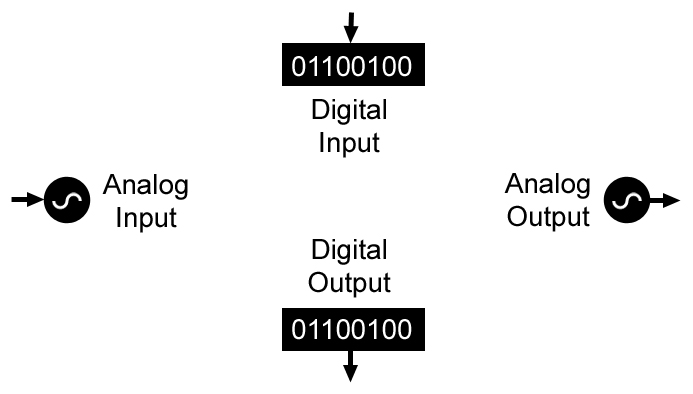
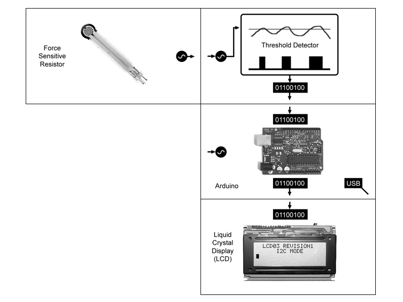
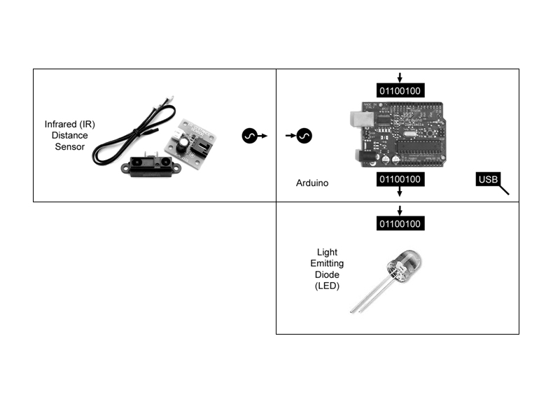
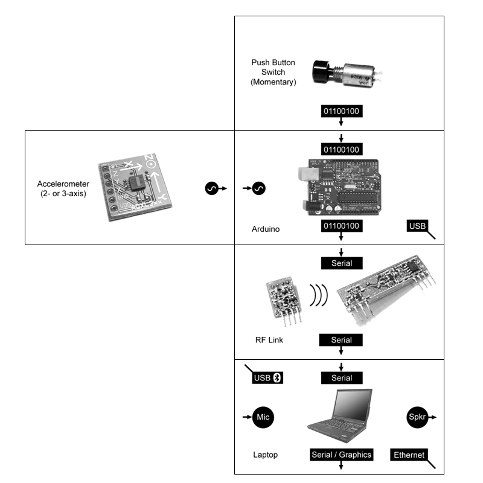

# Physical Computing Cards

_November 20, 2007_  
Originally published at `https://digitalhistoryhacks.blogspot.com/2007/11/physical-computing-cards.html`

In most public history graduate programs (including the one that I teach in) students get a good grounding in presenting history to the public in the form of images, texts and objects of material culture. Our program[^1], like a growing number of others, also emphasizes the public historian's need to be able to communicate using various new media. Each year we try to add new tools and new techniques. The digital world is, of course, changing much faster than we can keep up with; typical undergraduate curricula change a lot less rapidly than I'd like. Our students respond to the challenge in various ways. Some seem to dislike drinking from the firehose while others[^2] are more willing to take it in stride.  

I don't think that the idea of simply *presenting* history goes far enough, however. Over the past few years, I've begun to think of the public historian's problem as one of interaction design. When we've done our job, we will be able to describe not only how members of the public respond to our work, but how our work responds to them. It will be appropriate, in other words, to think of our work in terms of how it *behaves*.  

For my long-suffering students, this means the need to learn more about computers than many would prefer. The computer, after all, is the most behaviorally plastic artifact that has ever been created. If we can specify an interaction algorithmically, we can implement at least part of it on a computer. Public history, however, is conducted in a number of venues and settings that make it impractical to use a desktop or laptop computer. In previous years the public history students, some colleagues and I have used GPS-enabled handheld computers to move pieces of the archive into the field (more information here[^3]). This year, I'm trying to expand our repertoire to include the use of microcontrollers and transducers, an approach that is nicely covered in O'Sullivan and Igoe's *Physical Computing[^4]* and Igoe's new *Making Things Talk[^5]*.  

Most of my students have had little or no exposure to electronics and don't really have a sense of how to put off-the-shelf hardware modules together to create useful effects. We don't have a workshop space where people can solder (at least not yet) and don't have enough equipment for each student to build his or her own project. To get around some of these difficulties, I decided to create a collection of cards that can be laser printed on business card stock. Each card shows a picture of a device and has little glyphs along the sides that indicate how it can be combined with other devices. The basic scheme is laid out like this:  

  

I'm planning to use the cards in studio by talking through some of the basic principles of physical computing and describing how particular effects or installations might be created. Suppose, for example, that you wanted a museum exhibit to sense the presence of a viewer, try to figure out if it was a child or adult, and adjust the wording of the artifact captions accordingly. One way to implement something like that would be to use force sensitive resistors hidden in a floor mat to determine the person's weight, and establish one or more thresholds to set an appropriate caption, which would then be displayed on an LCD. All of the computation could be done onboard a microcontoller module like Arduino[^6]. Using these cards to create a block diagram the system might look something like this:  

  

Having explained a bit about how each module works, I can then pose a series of increasingly difficult design challenges and talk through their ideas with them. How would you make a light come on to illuminate a panel when someone approaches?  

  

Given our available equipment, the designs can be more elaborate. How would you build a Wii-style wireless remote into a replica of some historical scientific apparatus? One possibility might look something like this:  

  

PDF pages of the cards that I've made so far are here[^7] (8Mb). If you are interested in printing your own, you can contact me for a zipped file of the JPEGs of individual cards.  

Tags: digital history[^8] \| history appliances[^9] \| interaction design[^10] \| pedagogy[^11] \| physical computing[^12] \| public history[^13]

---

Previous: [How To: Make a Museum Exhibit Mockup with Free Tools, Part 3](20071113-how-to-make-museum-exhibit-mockup-with-8511.md)  
Next: [Geo-DJ, Part 1: The Idea](20071203-geo-dj-part-1-idea.md)  
[Back to the blog archive](../README.md)

[^1]: `http://history.uwo.ca/gradstudy/publichistory/`
[^2]: `http://p-stewart.blogspot.com/2007/11/ending-our-fences.html`
[^3]: `http://digitalhistory.uwo.ca/pbc/`
[^4]: `http://www.amazon.com/Physical-Computing-Sensing-Controlling-Computers/dp/159200346X/`
[^5]: `http://www.amazon.com/Making-Things-Talk-Practical-Connecting/dp/0596510519/`
[^6]: `http://www.arduino.cc`
[^7]: `https://sites.google.com/site/digitalhistoryhacks/Home/data-files/physcomp-cards-01-04.pdf`
[^8]: `http://technorati.com/tag/digital+history`
[^9]: `http://technorati.com/tag/history+appliances`
[^10]: `http://technorati.com/tag/interaction+design`
[^11]: `http://technorati.com/tag/pedagogy`
[^12]: `http://technorati.com/tag/physical+computing`
[^13]: `http://technorati.com/tag/public+history`
