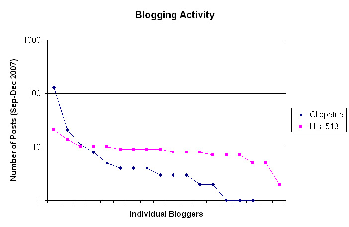

# On Blogs and Frogs

_December 28, 2007_  
Originally published at `https://digitalhistoryhacks.blogspot.com/2007/12/on-blogs-and-frogs.html`

[Cross-posted to Cliopatria & Digital History Hacks]  

Last week some time, my eyes popped open in the middle of the night and I realized that it's been quite a while since I blogged. I was too tired to get up and rectify the situation, but, of course, that didn't stop me from lying there half-awake and thinking about blogging. My mind turned to the fact that I've been even more remiss about cross-posting to Cliopatria from time to time. I imagined that some Cliopatrians (O.K., Ralph E. Luker[^1]) were probably posting more than a hundred times for each one time that I managed to.  

From there I got to thinking about the students in my digital history grad class[^2]. They have to blog as the written component of their coursework. Although I'm very explicit about my preference for quality over quantity, you'd think that they would be motivated to produce approximately the same amount of written work as one another. Nevertheless, I had a sense that there could easily be an order of magnitude difference in output between the most and least-frequent posters. I tried to visualize what the distributions would look like: probably a power law[^3]. Since that night, I've had a chance to check. The figure below shows the number of times that various members of Cliopatria and of my grad class posted between the beginning of September and now.  

  

I think most academics, including my students, quickly learn that they have strong preferences for some kinds of writing rather than others. One person likes to write abstruse monographs, one popular books, one carefully-crafted essays. Some of us have found that we're able to blog and some people seem to be especially good at it. There's an ecology of scholarly production, and we all have to find our niche.  

So I was lying there thinking about blogs and I realized that it reminded me of something, what was it? Oh yeah, frog communication. (It was the middle of the night.) Many years ago I read an utterly charming paper on the subject in *Scientific American*, and it's stuck with me (Peter M. Narins, "Frog Communication," *Sci Am*, Aug 1995, 78-83). In its efforts to attract females, the male coqui, a tiny Puerto Rican frog, makes a chirping call that is louder than a jackhammer. This raises many questions, not the least of which is "how [does] such a small creature protect itself from its own racket?" The answer turns out to be a fascinating lesson in evolution and engineering, so be sure to read the paper. What's interesting from the point of view of blogging, or scholarly production more generally, is that the frogs also have a special neural mechanism that follows the periodic calls made by other creatures, predicts windows of relative silence, and allows them to blast their own calls into the gaps.  

Now based on my own experience to date, I rarely blog in response to external factors. Instead, I blog when I can get up the gumption to do so. Like many scholars, I've grown used to the idea that when you write something, you're adding it to a body of knowledge that is growing, if not monotonically, at least pretty steadily. On that view, the relative timing of different contributions doesn't matter so much, unless you're in a race for the Nobel prize or something. As historians, we can usually afford to take the long view.  

Frogs, however, don't take the long view. As Charles F. Hockett argued in another classic *Scientific American* article, human language is apparently unique among animal communication systems because it allows us "to talk about things that are remote in space or time (or both) from where the talking goes on" ("The Origin of Speech," *Sci Am*, Sep 1960, 89-96). For the frog, there's *right here, right now*, give or take a few hundred milliseconds to squeeze in the call where it is most likely to be heard.  

Thinking about blogging as a contribution to an infinite archive pushes us a bit too close to the frog's view of the world for comfort. Imagine having to squeeze your post in *right here, right now*, the only place where it has a hope of making any difference for anybody. The history blogosphere is already too vibrant, too far-flung for most people to monitor effectively. As more voices are added to the cacophony it's going to become harder and harder to be heard. How can we hope to get it right? Here's where we have a real advantage over the frog. We have the ability to create machines which simulate neural and evolutionary processes. Imagine the blogger of the future, augmented by an artificial system that monitors discourse, predicts gaps and pops in your contribution when and where it's most likely to be cited. Over time, the system learns what you are capable of, and becomes more effective at getting your message out. Does that sound crazy? Ribbit!  

Tags: blogs[^4] \| Cliopatria[^5] \| Eleutherodactylus coqui[^6] \| findability[^7] \| machine learning[^8]

---

Previous: [Geo-DJ, Part 1: The Idea](20071203-geo-dj-part-1-idea.md)  
Next: [The Search Comes First](20080101-search-comes-first.md)  
[Back to the blog archive](../README.md)

[^1]: `http://www.ralphluker.com/`
[^2]: `http://digitalhistory.uwo.ca/h513_0708/`
[^3]: `http://www.shirky.com/writings/powerlaw_weblog.html`
[^4]: `http://technorati.com/tag/blogs`
[^5]: `http://technorati.com/tag/cliopatria`
[^6]: `http://technorati.com/tag/eleutherodactylus+coqui`
[^7]: `http://technorati.com/tag/findability`
[^8]: `http://technorati.com/tag/machine+learning`
