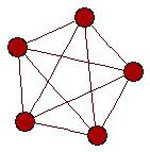
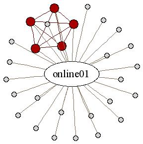
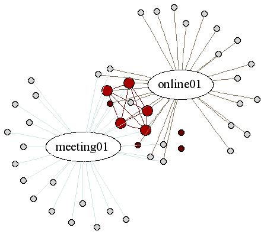
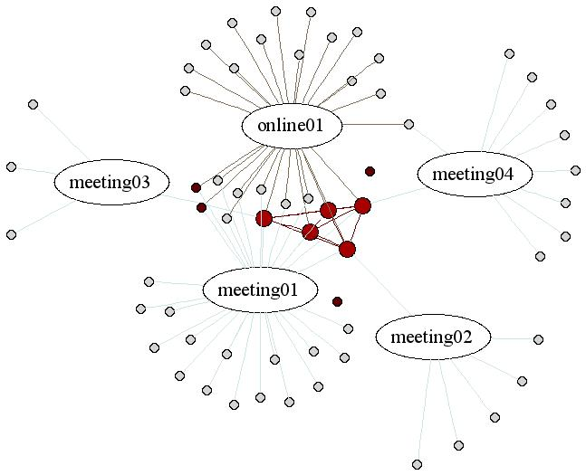
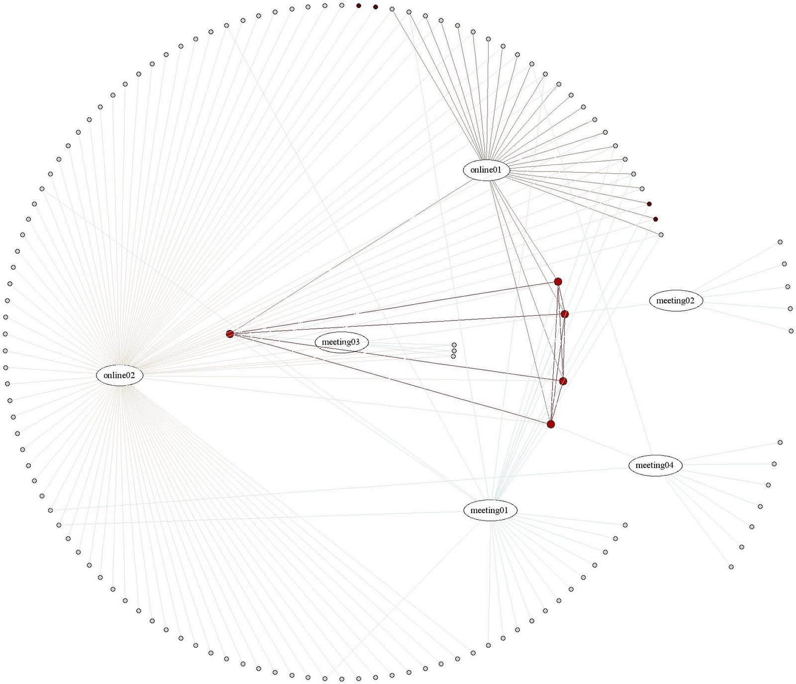
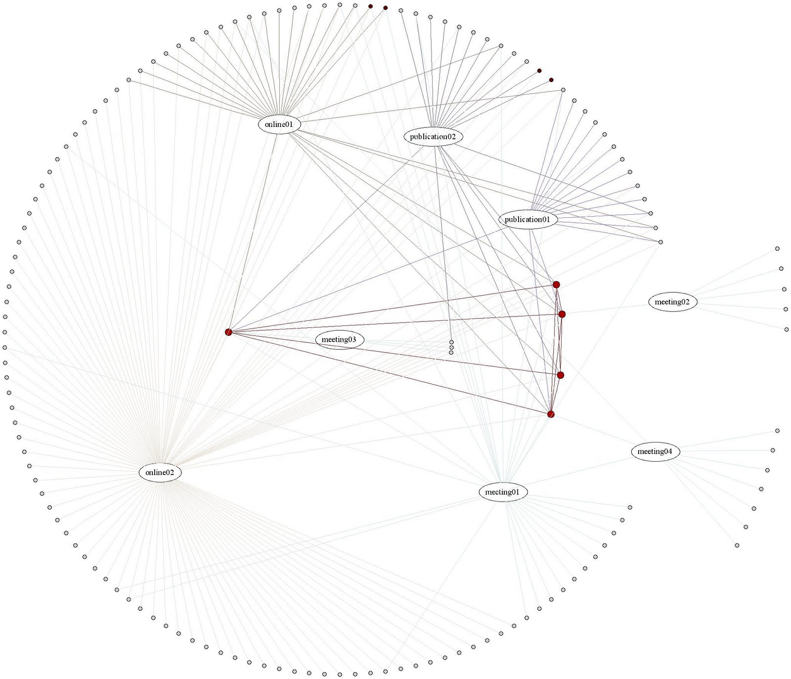
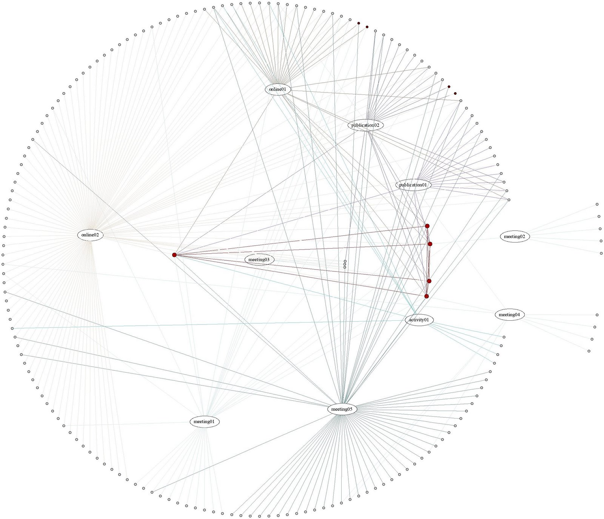
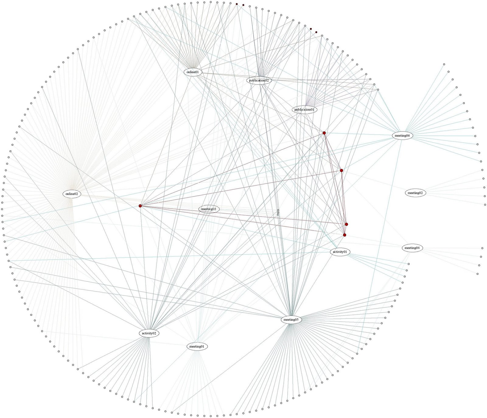

# Visualizing the Emergence of a Strategic Knowledge Cluster

_April 5, 2008_  
Originally published at `https://digitalhistoryhacks.blogspot.com/2008/04/visualizing-emergence-of-strategic.html`

In the summer of 2004, when I had just arrived at the University of Western Ontario, my new colleague Alan MacEachern[^1] invited me to join a small group that was putting together a grant application. The federal agency SSHRC[^2] had just announced funding for the design of something called 'research clusters'. At the time none of us was particularly clear what these clusters were supposed to be, and like many of the best kinds of opportunity, I don't think that SSHRC was really clear either. We eventually settled on the idea that the main task of clusters was 'knowledge mobilization', which left the matter nicely open.  

Our initial grant application was successful, and five of us set to work to develop NiCHE[^3], the Network in Canadian History & Environment / Nouvelle initiative canadienne en histoire de l'environnement. As we tried various things we kept track of activities and participants, allowing us to visualize the emergence of our research network. I should say up front that NiCHE doesn't *cause* research and is prohibited from directly funding research per se. Instead we find ways to facilitate research and training in environmental history broadly construed, and to mobilize the knowledge that researchers create.  

One of the tools that we use for visualization is an open source package called Graphviz[^4]. We create a file that specifies entities (people, publications, field trips, etc.) and the relationships between them, then we hand off that file to Graphviz, which uses sophisticated algorithms to figure out a neat way to plot the network. We've found such visualization to be very useful, even though it can only ever show the tip of a much larger social iceberg. In our graphs, two people may be linked because they attended the same meeting or each published a chapter in a book. Our data doesn't show whether they knew each other in grad school, have a longstanding rivalry, or both secretly like *Buffy the Vampire Slayer*.  

The original NiCHE executive group worked quite closely together. One of the interesting facts about networks is that the number of possible pairwise relations between entities grows much faster than the number of entities as the network gets larger. Two people have at most one relationship, three people can have three (AB, BC, AC), four people can have six (AB, AC, AD, BC, BD, CD). The ten possible pairwise relationships between the five of us looked like this:  

  

One of the first things that we tried to do was provide licenses for Groove collaborative software to all of the people who were interested in joining NiCHE. For people with Windows machines the software worked very well. Unfortunately, it never really worked for people with Macs. We had to supplement Groove with other software, find suboptimal workarounds, and eventually abandon it. For a while, however, it gave us a way to interact relatively closely with NiCHE members who also happened to be tech-savvy Windows users. Our network took on a hub-and-spoke form.  

  

To reach out to more potential participants, we formed an advisory group and held a meeting in Toronto. Instead of one hub, we now had two, with some bridging members who participated in both online and face-to-face activities.  

  

The executive group split up to host regional meetings in other cities across Canada.  

  

We put together an online directory so members could add information about themselves. The directory allowed us to contact people and tell them about upcoming activities. Since it was publicly accessible, the directory also allowed NiCHE members to learn more about one another.  

  

Although adding one's name to a directory is a relatively weak form of participation, we found that many people became more active in NiCHE over time. The network seemed to extend to new participants, many of whom would then get involved in a number of subsequent projects. There is a saying in free / open source software, "contribute nothing, expect nothing." Conversely we could say that the people who contributed something to NiCHE could expect something from us. Some of them contributed articles to a special issue[^5] of the journal *Environmental History*. Some contributed chapters to a new textbook, *Method and Meaning in Canadian Environmental History[^6]*.  

  

Subsequent activities like a summer school and a graduate student workshop brought in some new participants, and brought back many more:  

  

  

When SSHRC announced a much larger grant for strategic knowledge clusters, we were able to include a version of the last figure as part of our application. (The Graphviz script that generated it is here[^7].)  

A year and half later, we're in the process of scaling up NiCHE activities by a couple of orders of magnitude. Network visualization gives us some insight into the work of a few hundred people who are loosely affiliated with NiCHE and collaborating in many different ways. We can identify people who have energy and initiative to share, and try to help them. Some provide 'bonding capital', tying tightly-linked groups closer together. Some provide 'bridging capital', mobilizing knowledge from one region or disciplinary specialization to another. We can also be more strategic about developing the connections that still need to be made, to make our network stronger and more effective. (For more about social networks, see Clay Shirky's new *Here Comes Everybody[^8]*.)  

What is more exciting is that we are getting closer to the point where we can make these kind of tools available to everyone in NiCHE. People will be able to enter their own information about research collaborations and interests, and explore social connections within the network. It will become much easier to find joint acquaintances to make introductions or to find people with particular skills or expertise.  

Tags: Graphviz[^9] \| social network analysis[^10] \| SSHRC (Social Sciences and Humanities Research Council of Canada)[^11] \| visualization[^12]

---

Previous: [Monitoring the Backchannel](20080325-monitoring-backchannel.md)  
Next: [Fitness Functions](20080410-fitness-functions.md)  
[Back to the blog archive](../README.md)

[^1]: `http://history.uwo.ca/faculty/maceachern/`
[^2]: `http://www.sshrc.ca/`
[^3]: `http://niche.uwo.ca`
[^4]: `http://www.graphviz.org/`
[^5]: `http://niche.uwo.ca/node/157`
[^6]: `http://hed.nelson.com/nelsonhed/instructor.do?pagefrom=search&disciplinenumber=21&product_isbn=9780176441166`
[^7]: `http://digitalhistory.uwo.ca/dhh/hacks/generalized-network-growth.dot.html`
[^8]: `http://www.amazon.com/Here-Comes-Everybody-Organizing-Organizations/dp/1594201536/`
[^9]: `http://technorati.com/tag/graphviz`
[^10]: `http://technorati.com/tag/social+network+analysis`
[^11]: `http://technorati.com/tag/sshrc`
[^12]: `http://technorati.com/tag/visualization`
